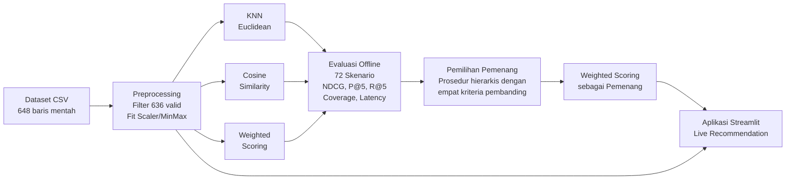

# 01 — Gambaran Umum Proyek

> Dokumen ini adalah pintu masuk ke dokumentasi teknis proyek. Untuk detail data dan preprocessing, baca [02_DATASET_AND_PREPROCESSING.md](./02_DATASET_AND_PREPROCESSING.md). Untuk detail algoritma, baca [03_RECOMMENDATION_METHODS.md](./03_RECOMMENDATION_METHODS.md). Untuk metodologi evaluasi, baca [04_METHODOLOGY_AND_EVALUATION.md](./04_METHODOLOGY_AND_EVALUATION.md). Untuk implementasi aplikasi, baca [05_APPLICATION_AND_CODEBASE.md](./05_APPLICATION_AND_CODEBASE.md).

---

## 1.1 Judul Penelitian

**Perbandingan Metode K-Nearest Neighbors, Cosine Similarity, dan Weighted Scoring pada Sistem Rekomendasi Laptop Berdasarkan Kebutuhan Hardware untuk Android Developer**

---

## 1.2 Latar Belakang

Pengembangan aplikasi Android dengan Android Studio menghadirkan beban kerja komputasi yang khas:

- **Kompilasi Kotlin/Java melalui Gradle** — proses build yang bersifat intensif secara CPU dan dapat memanfaatkan kemampuan multi-core.
- **Android Virtual Device (AVD)** — emulator lokal yang membutuhkan RAM besar dan dukungan virtualisasi perangkat keras.
- **Multitasking pengembang** — IDE, browser dokumentasi, perangkat desain (Figma), dan perangkat backend (Docker/lokal server) berjalan bersamaan.

Ketika seorang pengembang atau mahasiswa hendak memilih laptop untuk keperluan ini, mereka dihadapkan pada:

1. **Katalog yang luas** — ratusan model dengan spesifikasi yang beragam.
2. **Spesifikasi parsial** — daftar dari penjual sering kali tidak menyertakan skor benchmark CPU/GPU secara eksplisit.
3. **Perbandingan multi-kriteria** — tidak ada satu metrik tunggal yang cukup; RAM, kecepatan CPU, dan kapasitas penyimpanan semuanya relevan.

Proyek ini membangun sebuah sistem rekomendasi berbasis *content-based filtering* yang membandingkan tiga metode secara kuantitatif, lalu mengekspos metode terbaik sebagai aplikasi web interaktif.

---

## 1.3 Pertanyaan Penelitian

> Metode sistem rekomendasi mana — K-Nearest Neighbors (KNN) Euclidean, Cosine Similarity, atau Weighted Scoring — yang menghasilkan performa terbaik untuk merekomendasikan laptop bagi pengembang Android, diukur menggunakan metrik NDCG@5, Precision@5, Recall@5, Coverage, dan Latency?

---

## 1.4 Batasan Penelitian

| Aspek | Yang Dilakukan | Yang Tidak Dilakukan |
|---|---|---|
| Pendekatan | *Content-Based Filtering* | *Collaborative Filtering*, *Hybrid* |
| Metode dibandingkan | KNN Euclidean, Cosine Similarity, Weighted Scoring | Deep learning, Learning-to-Rank |
| Evaluasi | *Offline benchmark* pada 72 skenario sintetis | Studi pengguna, A/B test nyata |
| Data | Katalog satu retailer (636 laptop valid) | Multi-retailer, crowdsourced data |
| Atribut ranking | RAM, CPU PassMark, Storage | GPU ranking, layar, bobot, baterai |
| Target beban kerja | Pengembangan Android | Desain grafis, gaming, video editing |

---

## 1.5 Alur Kerja Keseluruhan

---

## 1.6 Hubungan antara Penelitian dan Aplikasi

Aplikasi Streamlit berfungsi sebagai **demonstrasi penelitian**, bukan sekadar kalkulator rekomendasi. Spesifikasi evaluasi (`docs/EVALUATION_SPEC.md`) mendefinisikan dua bagian fungsional utama: *Laptop Recommendation* (rekomendasi untuk pengguna akhir) dan *Model Evaluation* (laporan komparatif). Implementasi `streamlit_app.py` mewujudkan kedua bagian ini dalam tiga tab, dengan tab ketiga memisahkan penjelasan edukatif dari laporan evaluasi:

| Tab | Nama | Fungsi |
|---|---|---|
| **Tab 1** (halaman utama) | **Evaluasi Model** | Menampilkan hasil benchmark penuh dari 72 skenario untuk ketiga metode (*Model Evaluation*). Pembaca penelitian dapat memverifikasi seluruh hasil secara interaktif. |
| **Tab 2** | **Uji Rekomendasi** | Menggunakan **hanya Weighted Scoring** (pemenang evaluasi) untuk memberikan rekomendasi laptop secara langsung berdasarkan preset beban kerja dan anggaran pengguna (*Laptop Recommendation*). |
| **Tab 3** | **Dasar Sistem Rekomendasi** | Penjelasan edukatif tentang cara kerja ketiga metode, dasar pemilihan atribut, dan cara membaca hasil rekomendasi. Tab ini merupakan tambahan implementasi yang memisahkan konten edukatif dari laporan evaluasi. |

Pemisahan ini memastikan bahwa keputusan metode yang digunakan dalam aplikasi secara eksplisit dapat ditelusuri ke hasil evaluasi ilmiah, bukan hanya pilihan desain.

---

## 1.7 Teknologi yang Digunakan

| Komponen | Teknologi | Versi Minimum |
|---|---|---|
| Bahasa | Python | 3.12 |
| Antarmuka web | Streamlit | ≥ 1.40 |
| Manipulasi data | pandas | ≥ 2.0 |
| Komputasi numerik | NumPy | ≥ 1.24 |
| Algoritma ML | scikit-learn | ≥ 1.3 |
| Penyimpanan data | CSV (tanpa database aktif) | — |

---

## 1.8 Referensi Silang

- Dataset dan preprocessing → [02_DATASET_AND_PREPROCESSING.md](./02_DATASET_AND_PREPROCESSING.md)
- Detail algoritma → [03_RECOMMENDATION_METHODS.md](./03_RECOMMENDATION_METHODS.md)
- Metodologi evaluasi dan hasil → [04_METHODOLOGY_AND_EVALUATION.md](./04_METHODOLOGY_AND_EVALUATION.md)
- Implementasi aplikasi → [05_APPLICATION_AND_CODEBASE.md](./05_APPLICATION_AND_CODEBASE.md)
- Spesifikasi evaluasi terkunci → [EVALUATION_SPEC.md](./EVALUATION_SPEC.md)

