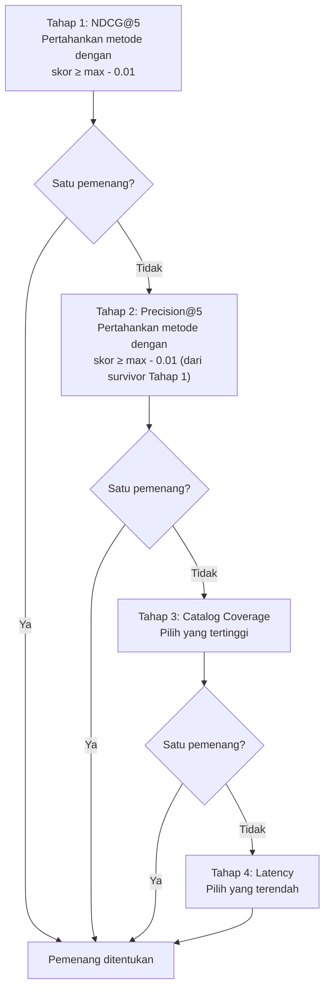

# 04 — Metodologi dan Evaluasi

> Dokumen ini menjelaskan desain evaluasi offline, metrik yang digunakan, prosedur pengukuran, hasil benchmark, dan pemilihan pemenang. Untuk memahami metode yang dievaluasi, lihat [03_RECOMMENDATION_METHODS.md](./03_RECOMMENDATION_METHODS.md). Spesifikasi lengkap terkunci ada di [EVALUATION_SPEC.md](./EVALUATION_SPEC.md).

---

## 4.1 Desain Evaluasi

Penelitian ini menggunakan pendekatan **offline controlled benchmark**: tidak ada pengguna nyata yang terlibat; seluruh evaluasi dilakukan pada skenario sintetis yang didesain secara sistematis.

**Alasan pendekatan offline:**
- Studi pengguna nyata memerlukan waktu lama dan partisipan yang representatif.
- Offline benchmark memungkinkan reproduksibilitas penuh dan perbandingan yang terkontrol.
- Semua skenario menggunakan kondisi yang identik untuk ketiga metode.

Implementasi: `core/evaluator.py` → kelas `OfflineEvaluator`.

---

## 4.2 Grid Skenario 72 Kasus

Evaluasi dilakukan pada **72 skenario** yang dihasilkan dari kombinasi grid berikut:

| Dimensi | Nilai | Jumlah |
|---|---|---:|
| Target RAM | 16 GB, 24 GB, 32 GB | 3 |
| Target Storage | 512 GB, 1.024 GB | 2 |
| Target CPU PassMark | 14.823 (Q1), 18.871 (Median), 24.969 (Q3) | 3 |
| Anggaran | Rp12 juta, Rp18 juta, Rp25 juta, Rp40 juta | 4 |
| **Total** | **3 × 2 × 3 × 4** | **72** |

Nilai CPU dipilih dari kuartil distribusi dataset untuk mewakili kondisi permintaan rendah, sedang, dan tinggi.

Implementasi: `generate_72_scenarios()` di `core/evaluator.py`.

---

## 4.3 Penilaian Relevansi Berbasis Aturan

Untuk setiap skenario, setiap laptop dalam kandidat pool diberi **tingkat relevansi** (*relevance grade*) dari 0 hingga 3, menggunakan aturan hierarkis yang bersifat *mutually exclusive* (saling lepas) dan *exhaustive* (menyeluruh di dalam pool).

> [!IMPORTANT]
> Label relevansi ini adalah standar evaluasi heuristik proyek, bukan ukuran kepuasan pengguna nyata maupun jaminan performa di dunia nyata.

Aturan diterapkan secara berurutan — sebuah laptop hanya masuk ke grade pertama yang kondisinya dipenuhi:

**Grade 3 — Memenuhi Seluruh Target (*Fully Meets Defined Targets*):**

$$\text{ram}(x) \ge \text{target\_ram} \;\land\; \text{storage}(x) \ge \text{target\_storage} \;\land\; \text{cpu}(x) \ge \text{target\_cpu}$$

**Grade 2 — Memenuhi Target Komputasi Utama (*Mostly Meets Defined Targets*):**

Kandidat **tidak memenuhi Grade 3**, tetapi memenuhi:

$$\text{ram}(x) \ge \text{target\_ram} \;\land\; \text{cpu}(x) \ge \text{target\_cpu} \;\land\; \text{storage}(x) \ge 256$$

*(RAM dan CPU memenuhi target; storage di bawah target tetapi masih ≥ 256 GB.)*

**Grade 1 — Memenuhi Sebagian Target (*Partially Meets Defined Targets*):**

Kandidat **tidak memenuhi Grade 3 maupun Grade 2**, tetapi memenuhi salah satu dari tiga sub-kondisi berikut:

- **Kasus 1a:** $\text{ram}(x) \ge \text{target\_ram} \;\land\; 10.510 \le \text{cpu}(x) < \text{target\_cpu} \;\land\; \text{storage}(x) \ge 256$
  *(RAM memenuhi target; CPU di bawah target tetapi ≥ P10; storage ≥ 256 GB.)*
- **Kasus 1b:** $16 \le \text{ram}(x) < \text{target\_ram} \;\land\; \text{cpu}(x) \ge \text{target\_cpu} \;\land\; \text{storage}(x) \ge 256$
  *(RAM di bawah target tetapi ≥ 16 GB; CPU memenuhi target; storage ≥ 256 GB.)*
- **Kasus 1c:** $16 \le \text{ram}(x) < \text{target\_ram} \;\land\; 10.510 \le \text{cpu}(x) < \text{target\_cpu} \;\land\; \text{storage}(x) \ge 256$
  *(Defisit ganda ringan: RAM dan CPU keduanya di bawah target tetapi masih dalam ambang minimal; storage ≥ 256 GB.)*

**Grade 0 — Tidak Memenuhi Target (*Does Not Meet Defined Targets*):**

Seluruh kandidat dalam pool yang tidak memenuhi kriteria Grade 3, 2, maupun 1. Contoh: `cpu < 10.510`.

**Ambang batas CPU P10 = 10.510** adalah persentil ke-10 distribusi CPU PassMark dalam katalog referensi 636 laptop. Ini bukan standar resmi Google; merupakan keputusan proyek.

**Definisi "relevan" untuk P@5 dan R@5:** Laptop dengan tingkat relevansi ≥ 2 dianggap relevan.

Implementasi: `compute_ground_truth_relevance()` di `core/evaluator.py`.

---

## 4.4 Metrik Evaluasi

### 4.4.1 Precision@5 (P@5)

**Apa:** Proporsi dari 5 laptop yang direkomendasikan yang termasuk relevan (grade ≥ 2).

**Mengapa:** Mengukur *ketepatan* — seberapa banyak rekomendasi yang benar-benar berguna bagi pengguna.

**Formula:**

$$P@5 = \frac{|\text{relevan} \cap \text{top-5}|}{5}$$

Penyebut selalu 5, bahkan jika pool kandidat memiliki lebih sedikit dari 5 laptop. Semua 72 skenario valid untuk metrik ini.

---

### 4.4.2 Recall@5 (R@5)

**Apa:** Proporsi dari seluruh laptop relevan dalam pool yang masuk ke dalam top-5 rekomendasi.

**Mengapa:** Mengukur *kelengkapan* — seberapa banyak laptop yang seharusnya direkomendasikan berhasil ditemukan.

**Formula:**

$$R@5 = \frac{|\text{relevan} \cap \text{top-5}|}{|\text{relevan dalam pool}|}$$

> [!WARNING]
> **16 dari 72 skenario** memiliki nol laptop dengan grade ≥ 2 dalam pool kandidat. Penyebut = 0 → Recall tidak terdefinisi (NaN) untuk skenario tersebut. Hanya **56 skenario valid** yang digunakan untuk agregasi Recall.

---

### 4.4.3 NDCG@5 (Normalized Discounted Cumulative Gain)

**Apa:** Metrik kualitas pemeringkatan (*ranking quality*) yang memperhitungkan posisi setiap laptop yang direkomendasikan dan tingkat relevansinya. Item yang sangat relevan (grade 3) di peringkat teratas berkontribusi lebih besar pada skor dibandingkan item yang sama di peringkat yang lebih rendah.

**Mengapa:** NDCG@5 cocok sebagai metrik evaluasi utama karena memperhitungkan tingkat relevansi setiap laptop sekaligus posisi laptop tersebut dalam urutan rekomendasi. Laptop dengan tingkat relevansi lebih tinggi yang ditempatkan pada posisi teratas akan memberikan kontribusi lebih besar terhadap skor.

**Formula:**

$$DCG@5 = \sum_{k=1}^{5} \frac{2^{g_k} - 1}{\log_2(k + 1)}$$

$$NDCG@5 = \frac{DCG@5}{IDCG@5}$$

di mana:
- $g_k$ = tingkat relevansi laptop di posisi ke-$k$ (0, 1, 2, atau 3)
- $IDCG@5$ = DCG ideal — dihitung dari urutan optimal (grade tertinggi di posisi 1)
- Rentang NDCG: [0, 1]; nilai 1,0 berarti urutan sempurna

Semua 72 skenario valid untuk NDCG (tidak ada masalah zero-denominator seperti Recall).

---

### 4.4.4 Catalog Coverage

**Apa:** Proporsi laptop unik yang muncul dalam rekomendasi dari seluruh 72 skenario, dibagi total katalog.

**Formula:**

$$\text{Catalog Coverage} = \frac{|\text{laptop unik yang direkomendasikan dari 72 skenario}|}{636}$$

$$\text{Eligible-Pool Coverage} = \frac{|\text{laptop unik yang direkomendasikan}|}{428}$$

Coverage mengukur **konsentrasi rekomendasi** lintas skenario. Metode dengan coverage rendah lebih terkonsentrasi pada sekumpulan laptop yang sama di berbagai skenario; metode dengan coverage tinggi menghasilkan rekomendasi yang lebih beragam.

---

### 4.4.5 Latency (Waktu Respons)

**Apa:** Waktu komputasi untuk menghasilkan rekomendasi, dalam milidetik.

**Protokol pengukuran:**
1. Untuk setiap skenario: jalankan 10 kali berturut-turut.
2. Buang 2 run pertama (warmup — JIT compilation / cache loading).
3. Gunakan **8 run tersisa** untuk menghitung median dan IQR per skenario.
4. Agregasi final = **median dari 72 median skenario**.

Implementasi: `measure_scenario_latency()` di `core/evaluator.py`.

---

## 4.5 Hasil Benchmark

Semua nilai di bawah ini bersumber langsung dari artefak evaluasi yang terkunci di `evaluation/`.

### 4.5.1 Tabel Metrik Utama

| Metrik | KNN Euclidean | Cosine Similarity | Weighted Scoring |
|---|---:|---:|---:|
| **Mean NDCG@5** | 0,773432 | 0,698774 | **0,978585** |
| SD NDCG@5 | 0,296052 | 0,365699 | 0,100721 |
| Median NDCG@5 | 0,967467 | 0,887539 | 1,000000 |
| **Mean Precision@5** | 0,480556 | 0,494444 | **0,738889** |
| Mean Recall@5 *(56 skenario valid)* | 0,149185 | 0,142323 | **0,263618** |
| **Catalog Coverage** | 0,144654 | **0,198113** | 0,050314 |
| Eligible-Pool Coverage | 0,214953 | **0,294393** | 0,074766 |
| Latency Median (ms) | 7,0474 | 6,8170 | **6,3049** |
| Latency IQR (ms) | 0,9272 | 0,8636 | 0,9200 |

> [!NOTE]
> Bold menunjukkan nilai terbaik untuk setiap metrik. Weighted Scoring merupakan metode dengan performa terbaik berdasarkan kriteria relevansi penelitian dan skenario evaluasi yang digunakan — unggul di NDCG@5, Precision@5, Recall@5, dan Latency. Cosine Similarity unggul di Catalog Coverage.

### 4.5.2 Validitas Skenario

| Metrik | Skenario Valid |
|---|---:|
| NDCG@5 | 72 / 72 |
| Precision@5 | 72 / 72 |
| Recall@5 | 56 / 72 (16 dikecualikan karena nol relevan) |
| Latency | 72 / 72 × 8 pengukuran = 576 per metode |

---

## 4.6 Pemilihan Pemenang: Prosedur Hierarkis Empat Kriteria

Pemenang dipilih menggunakan prosedur hierarkis dengan empat kriteria pembanding yang telah ditetapkan secara apriori sebelum evaluasi dijalankan. Implementasi: `select_winner_hierarchical()` di `core/evaluator.py`.

> [!NOTE]
> **Recall@5 tidak digunakan sebagai kriteria pemilihan pemenang** karena 16 dari 72 skenario menghasilkan nilai NaN.

### 4.6.1 Hasil Pemilihan

| Tahap | Survivor | Keterangan |
|---|---|---|
| Tahap 1 (NDCG@5) | **Weighted Scoring saja** | NDCG = 0,978585. Gap dari KNN = 0,205153 >> ambang 0,01. |
| Tahap 2–4 | — | Tidak diperlukan; Weighted Scoring menang di Tahap 1. |

**Pemenang: Weighted Scoring** (ditetapkan di Tahap 1 saja).

Detail: `evaluation/winner_decision.json`.

---

## 4.7 Analisis Trade-off

| Dimensi | Weighted Scoring | KNN Euclidean | Cosine Similarity |
|---|---|---|---|
| **Kualitas Pemeringkatan (NDCG@5)** | Terbaik (0,978) | Sedang (0,773) | Rendah (0,699) |
| **Ketepatan (P@5)** | Terbaik (0,739) | Sedang (0,481) | Sedang (0,494) |
| **Konsentrasi Rekomendasi** | Paling terkonsentrasi (5,03%) | Sedang (14,47%) | Paling beragam (19,81%) |
| **Kecepatan** | Tercepat (6,30 ms) | Paling lambat (7,05 ms) | Sedang (6,82 ms) |
| **Konsistensi** | Paling konsisten (SD NDCG 0,101) | Kurang konsisten (0,296) | Paling tidak konsisten (0,366) |

**Interpretasi Coverage:** Weighted Scoring hanya merekomendasikan 32 laptop unik dari 636 (5,03%) di seluruh 72 skenario. Ini menunjukkan bahwa rekomendasi lebih terkonsentrasi pada sekumpulan laptop tertentu di setiap kategori harga. Cosine Similarity menghasilkan rekomendasi yang paling beragam (126 laptop unik, 19,81%).

---

## 4.8 Keterbatasan Metodologi

| Keterbatasan | Dampak | Catatan |
|---|---|---|
| **Construct-alignment risk** | Weighted Scoring mungkin diuntungkan karena kriteria relevansi penelitian menggunakan dimensi yang sama dengan fungsi utilitasnya | Lihat [03_RECOMMENDATION_METHODS.md §3.4](./03_RECOMMENDATION_METHODS.md) |
| **Single-retailer snapshot** | Harga dan ketersediaan bisa berbeda di retailer lain | Data adalah snapshot Oktober 2026 |
| **Skenario sintetis ≠ pengguna nyata** | Preferensi pengguna nyata lebih kompleks dan tidak selalu linier | Studi pengguna nyata tidak dilakukan |
| **CPU PassMark adalah proxy** | Tidak mengukur waktu build Gradle secara langsung | Lihat [02_DATASET_AND_PREPROCESSING.md §2.8](./02_DATASET_AND_PREPROCESSING.md) |
| **Storage = kapasitas, bukan kecepatan** | SSD NVMe dan HDD sama-sama dihitung berdasarkan GB | Kecepatan baca/tulis tidak tersedia di dataset |
| **Grade relevansi = heuristik** | Bukan dari penilaian ahli atau pengguna nyata | Grade didefinisikan secara algoritmik |

---

## 4.9 Referensi

- Spesifikasi lengkap terkunci → [EVALUATION_SPEC.md](./EVALUATION_SPEC.md) (versi 2.1.0)
- Artefak benchmark → `evaluation/benchmark_results.csv`, `evaluation/summary_metrics.csv`
- Detail keputusan pemenang → `evaluation/winner_decision.json`
- Metadata run evaluasi → `evaluation/run_metadata.json`
- Implementasi → `core/evaluator.py`
- Metode yang dievaluasi → [03_RECOMMENDATION_METHODS.md](./03_RECOMMENDATION_METHODS.md)

