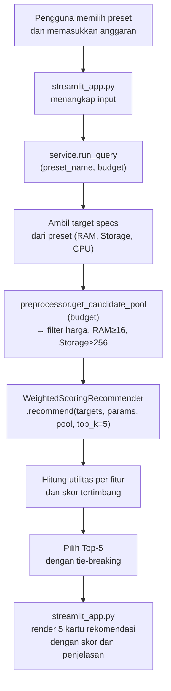

# 05 — Aplikasi dan Codebase

> Dokumen ini menjelaskan implementasi teknis aplikasi Streamlit: arsitektur kode, modul-modul, alur eksekusi, cara menjalankan aplikasi, dan cara menjalankan unit test. Untuk konteks penelitian, lihat [01_PROJECT_OVERVIEW.md](./01_PROJECT_OVERVIEW.md). Untuk algoritma, lihat [03_RECOMMENDATION_METHODS.md](./03_RECOMMENDATION_METHODS.md).

---

## 5.1 Teknologi

| Komponen | Teknologi | Versi Minimum |
|---|---|---|
| Bahasa | Python | 3.12 |
| Antarmuka web | Streamlit | ≥ 1.40 |
| Manipulasi data | pandas | ≥ 2.0 |
| Komputasi numerik | NumPy | ≥ 1.24 |
| Algoritma ML (Scaler) | scikit-learn | ≥ 1.3 |
| Penyimpanan data | CSV (tanpa database aktif) | — |

**Catatan arsitektur:** Proyek ini menggunakan **arsitektur CSV-only**. Tidak ada koneksi database (SQL, NoSQL, atau lainnya) yang aktif dalam versi final. Semua data dibaca dari file CSV pada saat startup aplikasi.

---

## 5.2 Struktur Direktori

```
laptop_recommender_app/
│
├── streamlit_app.py              # Entry point UI — antarmuka Streamlit 3-tab
├── service.py                    # Lapisan orkestrasi/service
├── requirement_mapper.py         # Pemetaan profil beban kerja → intensitas
│
├── core/
│   ├── __init__.py               # Package init; ekspor semua public API
│   ├── preprocessor.py           # Loading data, filter eligibility, fit scaler
│   ├── recommenders.py           # Implementasi 3 algoritma rekomendasi
│   └── evaluator.py              # Engine benchmark offline (72 skenario)
│
├── dataset/
│   └── laptops_benchmark_enriched_resolved.csv   # Dataset utama (636 laptop valid)
│
├── evaluation/                   # Artefak benchmark yang terkunci (READ-ONLY)
│   ├── benchmark_results.csv     # Hasil per-skenario per-metode
│   ├── summary_metrics.csv       # Agregasi metrik akhir
│   ├── winner_decision.json      # Keputusan pemenang + reasoning
│   └── run_metadata.json         # Metadata run (jumlah skenario, warmup, dll.)
│
├── knowledge_base/
│   └── workload_profiles.json    # KB rule-based untuk requirement_mapper.py
│
├── docs/                         # Dokumentasi teknis
│   ├── EVALUATION_SPEC.md        # Spesifikasi evaluasi terkunci (v2.1.0)
│   ├── 01_PROJECT_OVERVIEW.md
│   ├── 02_DATASET_AND_PREPROCESSING.md
│   ├── 03_RECOMMENDATION_METHODS.md
│   ├── 04_METHODOLOGY_AND_EVALUATION.md
│   ├── 05_APPLICATION_AND_CODEBASE.md (dokumen ini)
│   └── archive/                  # Dokumen historis
│
├── test_preprocessor.py          # 9 unit test untuk core/preprocessor.py
├── test_recommenders.py          # 15 unit test untuk core/recommenders.py
├── test_requirement_mapper.py    # 19 unit test untuk requirement_mapper.py
├── test_evaluator.py             # 8 unit test untuk core/evaluator.py
├── test_service.py               # 6 unit test untuk service.py
│
├── requirements.txt              # Dependensi Python
├── README.md                     # Panduan ringkas proyek
│
├── knn_v8_profile_recommender.py # PROTOTIPE LAMA — tidak aktif, referensi historis
└── inspection/                   # File eksplorasi Phase 1 (tidak aktif)
```

---

## 5.3 Tanggung Jawab Setiap Modul

### 5.3.1 `core/preprocessor.py`

**Tujuan:** Memuat dataset, membangun katalog referensi (636 laptop valid), menerapkan filter eligibility, dan menyiapkan parameter preprocessing.

**Kelas dan fungsi utama:**

| API | Deskripsi |
|---|---|
| `CatalogPreprocessor` | Singleton — memuat dan menyimpan dataset + parameter. Di-cache via `@st.cache_resource`. |
| `get_candidate_pool(budget)` | Mengembalikan DataFrame laptop yang memenuhi: harga ≤ budget, RAM ≥ 16 GB, Storage ≥ 256 GB |
| `validate_targets(targets)` | Memvalidasi dictionary target preferensi pengguna |
| `PreprocessingParameters` | Dataclass menyimpan `StandardScaler`, batas MinMax, dan metadata dataset |
| `_fit_preprocessing_parameters()` | Fit `StandardScaler` dan hitung batas MinMax dari 636 laptop |
| `_build_reference_catalog()` | Baca CSV, filter 12 laptop tanpa CPU PassMark, kembalikan 636 baris |

**Konstanta penting:**
- `RANKING_FEATURES = ['ram_gb', 'storage_gb', 'cpu_passmark_mark']`
- `ELIGIBILITY_MIN_RAM_GB = 16`
- `ELIGIBILITY_MIN_STORAGE_GB = 256`

---

### 5.3.2 `core/recommenders.py`

**Tujuan:** Implementasi tiga algoritma rekomendasi — semua mewarisi dari `BaseRecommender`.

| API | Deskripsi |
|---|---|
| `BaseRecommender` | Kelas abstrak; mendefinisikan antarmuka `recommend()` |
| `KNNRecommender.recommend()` | Jarak Euclidean di ruang standar; ranking ascending |
| `CosineRecommender.recommend()` | Cosine Similarity di ruang MinMax; ranking descending |
| `WeightedScoringRecommender.recommend()` | Utility function piecewise + weighted sum; ranking descending |
| `_calculate_feature_utility(x, t, max_val)` | Fungsi utilitas piecewise untuk satu fitur |
| `_apply_tie_breaking(df, score_col)` | Toleransi 1e-7 → harga naik → index naik |

**Konstanta bobot:**
- `WEIGHT_RAM = 0.45`
- `WEIGHT_CPU = 0.35`
- `WEIGHT_STORAGE = 0.20`

---

### 5.3.3 `core/evaluator.py`

**Tujuan:** Engine evaluasi offline — menghasilkan dan menjalankan 72 skenario, menghitung metrik, mengukur latency, dan memilih pemenang.

| API | Deskripsi |
|---|---|
| `OfflineEvaluator` | Kelas utama evaluasi; mengorkestrasi seluruh pipeline |
| `generate_72_scenarios()` | Menghasilkan 72 `EvaluationScenario` dari grid 3×2×3×4 |
| `compute_ground_truth_relevance()` | Memberi grade 0–3 pada setiap laptop dalam pool |
| `calculate_scenario_metrics()` | Menghitung P@5, R@5, NDCG@5, Coverage |
| `measure_scenario_latency()` | 10 run, 2 warmup, 8 diukur; median + IQR |
| `select_winner_hierarchical()` | Pemilihan 4-tahap: NDCG → Precision → Coverage → Latency |

**Konstanta penting:**
- `CPU_P10_THRESHOLD = 10510.0` — ambang batas Grade 1

---

### 5.3.4 `service.py`

**Tujuan:** Lapisan orkestrasi antara UI (`streamlit_app.py`) dan engine rekomendasi (`core/`). Mendefinisikan 4 preset beban kerja dan menjalankan query rekomendasi.

**Fungsi utama:**
- `run_query(preset_name, budget)` → mengembalikan DataFrame 5 rekomendasi teratas

**Konstanta:**
```python
CPU_LEVEL_TARGETS = {
    "rendah":          10510,
    "menengah_bawah":  14823,
    "sedang":          18871,
    "tinggi":          24969,
    "sangat_tinggi":   34222,
}
```

**4 Preset beban kerja (didefinisikan dalam `service.py`):**

| Preset | RAM Target | Storage Target | CPU Level | Deskripsi Singkat |
|---|---:|---:|---|---|
| Pengembangan Ringan / Kuliah Dasar (`office`) | 16 GB | 512 GB | menengah_bawah (~14.823) | Proyek sederhana, pengujian pada perangkat fisik |
| Mobile Development / Android Studio (Standar) (`programming`) | 16 GB | 512 GB | sedang (~18.871) | Alur kerja harian pengembang dengan 1 emulator lokal |
| Mobile Dev + UI/UX & Asset Design (`design`) | 24 GB | 1.024 GB | tinggi (~24.969) | Alur kerja gabungan IDE, emulator, dan desain visual |
| Workstation / Multi-Emulator Intensif (`gaming`) | 32 GB | 1.024 GB | sangat_tinggi (~34.222) | Proyek kompleks, banyak emulator, kompilasi intensif |

---

### 5.3.5 `requirement_mapper.py`

**Tujuan:** Memetakan jawaban kuesioner aktivitas pengguna ke tingkat intensitas beban kerja (Light, Medium, Heavy) menggunakan sistem aturan berbasis pengetahuan.

**Dimensi kuesioner:**

| Dimensi | Pilihan |
|---|---|
| `testing_environment` | `physical_device`, `single_emulator`, `multiple_emulators`, `mixed` |
| `project_complexity` | `simple`, `medium`, `complex` |
| `build_frequency` | `occasional`, `frequent`, `intensive` |
| `concurrent_tools` | `ide_only`, `ide_emulator_browser`, `multiple_tools` |

**Output:** `IntensityResult` — objek dengan field `final_intensity` (Light/Medium/Heavy), `status`, dan `explanation`.

**Knowledge base:** `knowledge_base/workload_profiles.json` — 10 aturan bernama (MOB-HEAVY-01 hingga MOB-MED-04), dengan prioritas eksplisit. Kombinasi yang tidak tercakup menghasilkan status `unsupported_combination` (tidak ada fallback ke Medium secara otomatis).

---

### 5.3.6 `streamlit_app.py`

**Tujuan:** Entry point antarmuka web. Mendefinisikan 3 tab Streamlit dan mengorkestrasi tampilan hasil rekomendasi dan evaluasi.

**Struktur 3-tab:**

| Tab | Nama | Fungsi |
|---|---|---|
| Tab 1 (default) | **Evaluasi Model** | Menampilkan 7 bar chart hasil benchmark ketiga metode |
| Tab 2 | **Uji Rekomendasi** | Form input preset + budget → Top-5 rekomendasi via Weighted Scoring |
| Tab 3 | **Dasar Sistem Rekomendasi** | Penjelasan edukatif tentang metode, bobot, dan cara membaca skor |

**Fitur teknis:**
- `@st.cache_resource` — preprocessor di-cache setelah loading pertama; tidak di-reload ulang setiap interaksi
- Layout: `layout="wide"` untuk penggunaan lebar layar penuh
- 7 bar chart evaluasi (satu per metrik utama)

---

## 5.4 Alur Eksekusi: Live Recommendation



---

## 5.5 Cara Menjalankan Aplikasi

### Prasyarat

```bash
# Pastikan Python 3.12+ sudah terinstall
python --version

# Buat virtual environment (opsional tapi disarankan)
python -m venv .venv
.venv\Scripts\activate  # Windows
# atau
source .venv/bin/activate  # Linux/macOS
```

### Instalasi Dependensi

```bash
pip install -r requirements.txt
```

### Menjalankan Aplikasi

```bash
streamlit run streamlit_app.py
```

Aplikasi akan terbuka di browser pada `http://localhost:8501`. Tab **Evaluasi Model** adalah halaman default.

---

## 5.6 Cara Menjalankan Unit Test

```bash
# Di dalam virtual environment
.venv\Scripts\python.exe -m unittest test_preprocessor test_recommenders test_requirement_mapper test_evaluator test_service -v
```

**Hasil yang diharapkan:** 57 test, semua PASS, exit code 0.

### Distribusi Unit Test

| File Test | Modul yang Diuji | Jumlah Test |
|---|---|---:|
| `test_preprocessor.py` | `core/preprocessor.py` | 9 |
| `test_recommenders.py` | `core/recommenders.py` | 15 |
| `test_requirement_mapper.py` | `requirement_mapper.py` | 19 |
| `test_evaluator.py` | `core/evaluator.py` | 8 |
| `test_service.py` | `service.py` | 6 |
| **Total** | | **57** |

---

## 5.7 File yang Harus Tidak Dimodifikasi

File-file berikut adalah bagian dari penelitian yang telah selesai dan **tidak boleh diubah** tanpa alasan ilmiah yang terdokumentasi:

| File / Direktori | Alasan |
|---|---|
| `evaluation/*.csv`, `evaluation/*.json` | Artefak benchmark terkunci — hash diverifikasi |
| `dataset/laptops_benchmark_enriched_resolved.csv` | Dataset referensi terkunci |
| `docs/EVALUATION_SPEC.md` | Spesifikasi evaluasi terkunci (v2.1.0) |
| `core/*.py` | Implementasi algoritma yang telah dievaluasi |
| `test_*.py` | Unit test untuk verifikasi implementasi |

---

## 5.8 File Lainnya (Referensi Historis)

| File | Deskripsi |
|---|---|
| `knn_v8_profile_recommender.py` | Prototipe KNN lama (58 KB). **Tidak aktif** dalam aplikasi final. Tersimpan sebagai referensi historis pengembangan. |
| `inspection/` | 7 file CSV/JSON dari eksplorasi data Phase 1. Tidak digunakan dalam runtime. |
| `docs/archive/` | Dokumen historis yang telah digantikan oleh dokumentasi ini. |

---

## 5.9 Referensi Silang

- Gambaran penelitian → [01_PROJECT_OVERVIEW.md](./01_PROJECT_OVERVIEW.md)
- Dataset → [02_DATASET_AND_PREPROCESSING.md](./02_DATASET_AND_PREPROCESSING.md)
- Algoritma → [03_RECOMMENDATION_METHODS.md](./03_RECOMMENDATION_METHODS.md)
- Evaluasi dan hasil → [04_METHODOLOGY_AND_EVALUATION.md](./04_METHODOLOGY_AND_EVALUATION.md)

