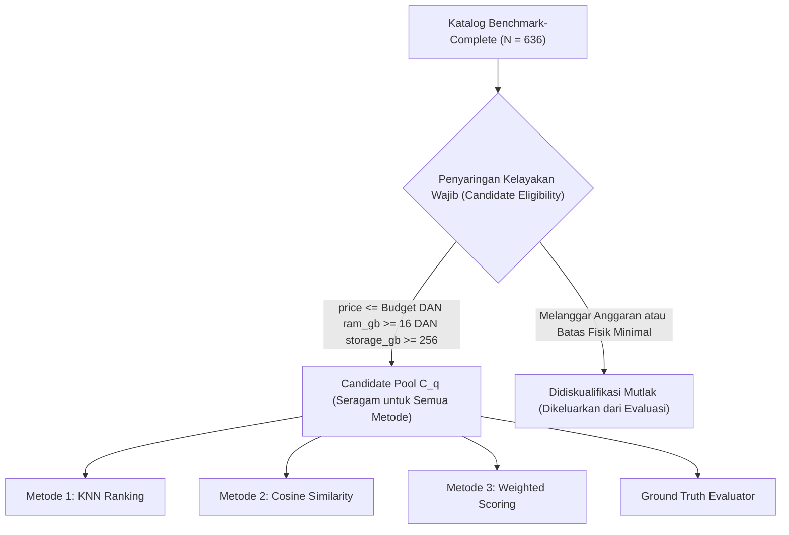
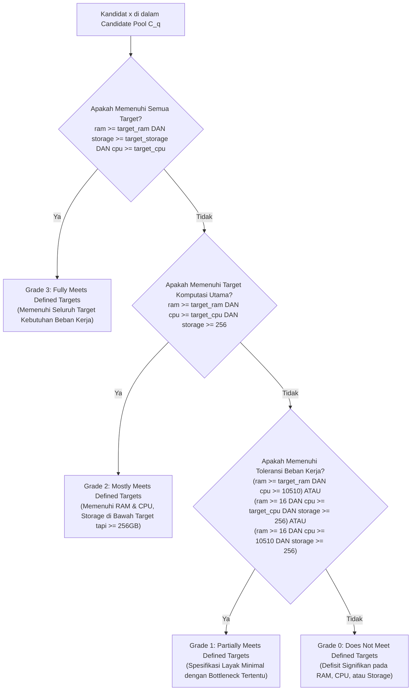
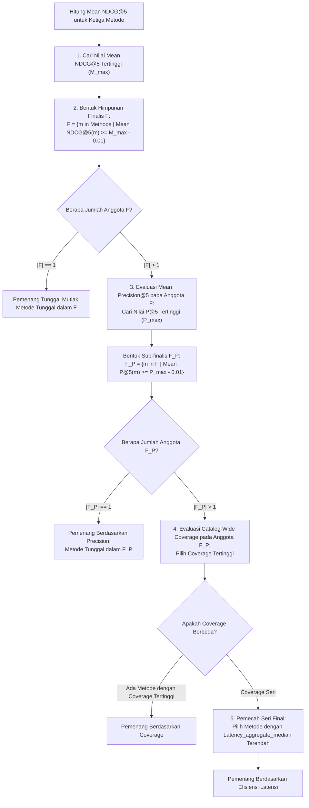
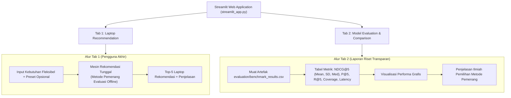

# Spesifikasi Metodologi Evaluasi Komparatif Sistem Rekomendasi Laptop
**Dokumen Standar Evaluasi Offline & Desain Eksperimen (docs/EVALUATION_SPEC.md)**  
**Versi:** 2.1.0 (Spesifikasi Final Terkunci & Siap Implementasi)  
**Tanggal:** 11 November 2026  
**Penulis:** Senior Machine Learning Engineer & Software Architect  
**Domain Studi:** Rekomendasi Laptop untuk Beban Kerja Android Development  

---

## 1. Pendahuluan dan Tujuan Evaluasi

### 1.1. Konteks Penelitian dan Tujuan Utama
Sistem rekomendasi laptop berbasis *Content-Based Filtering* sering kali dibangun hanya dengan satu metode tertentu tanpa pembuktian komparatif empiris. Penelitian ini bertujuan untuk melakukan **studi komparatif offline secara sistematis** terhadap tiga metode perekomendasi berbasis kemiripan konten:
1. **KNN-based Nearest-Neighbor Ranking** (menggunakan jarak metrik Euclidean terstandarisasi).
2. **Cosine Similarity** (menggunakan kosinus sudut vektor kebutuhan dan spesifikasi).
3. **Weighted Scoring / Multi-Attribute Utility Theory (MAUT)** (menggunakan agregasi linier skor utilitas terbobot).

Tujuan akhir penelitian adalah membandingkan performa ketiga metode tersebut pada kumpulan skenario kueri uji terkontrol dan memilih **satu metode terbaik (*single winning method*)** berdasarkan protokol evaluasi apriori. Metode pemenang ini akan diintegrasikan sebagai **satu-satunya mesin perekomendasi** pada antarmuka utama aplikasi web Streamlit.

### 1.2. Struktur Aplikasi Final
Aplikasi Streamlit final akan memiliki dua bagian utama:
1. **Laptop Recommendation (Rekomendasi Laptop Pengguna Akhir):**  
   Pengguna memasukkan preferensi perangkat keras secara fleksibel (anggaran, target RAM, target storage, preferensi prosesor). Sistem menghasilkan rekomendasi laptop terurut menggunakan **hanya metode pemenang hasil evaluasi offline**, dilengkapi kartu spesifikasi dan penjelasan kecocokan yang mudah dipahami. Sistem tidak menampilkan tiga daftar rekomendasi bersaing kepada pengguna akhir.
2. **Model Evaluation (Evaluasi dan Komparasi Model):**  
   Menyajikan hasil evaluasi komparatif offline ketiga metode secara transparan (tabel metrik evaluasi, visualisasi grafik, analisis distribusi performa, dan justifikasi ilmiah pemilihan metode pemenang). Bagian ini memuat hasil pra-kalkulasi dan tidak mengeksekusi ulang eksperimen setiap kali pengguna membuka aplikasi.

---

## 2. Dataset dan Pemilihan Fitur

### 2.1. Sumber dan Batasan Dataset
- **Sumber Data:** Dataset proyek tersimpan pada `dataset/laptops_benchmark_enriched_resolved.csv`, yang merupakan potret (*snapshot*) katalog toko Plaza IT per 5 Oktober 2026.
- **Ukuran Data:** Terdiri dari 648 rekaman laptop dan 21 atribut spesifikasi.
- **Populasi Evaluasi Acuan (*Benchmark-Complete Catalog*, $N=636$):**  
  Dari 648 rekaman, terdapat 636 laptop dengan skor PassMark CPU (`cpu_passmark_mark`) yang valid. Sebanyak 12 laptop (seluruhnya lini Apple MacBook Pro chip M4/M5 Pro/Max) tidak memiliki data PassMark CPU yang terpetakan (*UNMAPPED/AMBIGUOUS*).
  - **Kebijakan:** Seluruh eksperimen komparatif offline dilakukan secara eksklusif pada subset **636 laptop yang memiliki skor CPU PassMark valid**.
  - **Penolakan Imputasi:** Nilai benchmark yang hilang dilarang keras diimputasi dengan angka nol atau rata-rata sepihak, dan ketiadaan benchmark tidak boleh diartikan bahwa laptop tersebut kompatibel atau tidak kompatibel.
- **Batasan Representasi Pasar:** Dataset ini berasal dari satu peritel tunggal dan tidak mewakili seluruh pasar laptop di Indonesia.

### 2.2. Pemilihan Fitur Pemeringkatan Numerik
Beban kerja Android Development (Android Studio, Gradle build, emulator Android) pada dataset ini diwakili oleh tiga fitur numerik terverifikasi:
1. **RAM (`ram_gb`):** Kapasitas memori sistem fisik (rentang valid katalog: 4 s/d 64 GB).
2. **Storage (`storage_gb`):** Kapasitas ruang penyimpanan media dalam gigabyte (rentang valid katalog: 256 s/d 4.096 GB). Atribut ini murni mengukur kapasitas ruang tampung fisik, bukan kecepatan baca/tulis (*read/write speed*), generasi antarmuka SSD (SATA vs NVMe PCIe Gen 3/4), atau latensi I/O media penyimpanan.
3. **CPU Benchmark (`cpu_passmark_mark`):** Skor komposit PassMark CPU Mark sebagai proksi komputasi prosesor (rentang valid katalog: 1.763 s/d 62.164).

#### Nilai Statistik Terverifikasi pada Katalog Referensi ($N=636$):
- $\text{ram\_gb}$: $\min = 4$, $\max = 64$, $\mu = 17.33$, $\sigma = 8.95$.
- $\text{storage\_gb}$: $\min = 256$, $\max = 4.096$, $\mu = 683.87$, $\sigma = 368.30$.
- $\text{cpu\_passmark\_mark}$: $\min = 1.763,0$, $\max = 62.164,0$, $\mu = 21.509,30$, $\sigma = 11.076,82$.
- $\text{price\_numeric}$: $\min = \text{Rp } 4.999.000$, $\max = \text{Rp } 89.100.000$, $\mu = \text{Rp } 20.170.209,12$.

### 2.3. Pengecualian Fitur Harga, GPU, dan Core Count
1. **Harga (`price_numeric`):** Dikeluarkan dari vektor fitur pemeringkatan numerik guna mencegah kebocoran harga (*price leakage*). Harga hanya digunakan sebagai batasan kelayakan keras ($\text{price} \le \text{budget}$) dan kriteria pemecah seri pertama (*first tie-breaker*).
2. **Grafis GPU (`gpu_passmark_g3d_mark`):** Dikecualikan dari fitur pemeringkatan numerik wajib. Sebanyak 141 rekaman ($21.76\%$) tidak memiliki data PassMark G3D yang valid dan dataset sama sekali tidak memuat informasi kapasitas VRAM fisik mandiri maupun dukungan driver API grafis. Ketiadaan data ini menyebabkan kelayakan grafis GPU tidak dapat dievaluasi secara andal dari katalog yang ada. Oleh karena itu, kesesuaian grafis GPU dinyatakan berada di luar lingkup evaluasi numerik ini, dan ketiadaan nilai benchmark tidak boleh diinterpretasikan sebagai indikasi kompatibilitas maupun ketidakkompatibelan.
3. **Jumlah Core (`cpu_cores`, `gpu_cores`):** Memiliki nilai hilang $> 93\%$ pada katalog, sehingga dilarang digunakan dalam pemodelan kuantitatif.

---

## 3. Kelayakan Kandidat dan Pra-pemrosesan

### 3.1. Definisi Tunggal Candidate Pool ($\mathcal{C}_q$)
Ketiga metode rekomendasi dan modul evaluator ground truth **wajib menggunakan definisi candidate pool yang identik secara seragam**. Untuk setiap kueri evaluasi $q$, kandidat laptop $x$ berhak masuk ke dalam $\mathcal{C}_q$ jika dan hanya jika memenuhi seluruh batasan kelayakan wajib:
$$\mathcal{C}_q = \{x \in \mathcal{D}_{\text{valid}} \mid \text{price\_numeric}(x) \le \text{budget}_q \;\land\; \text{ram\_gb}(x) \ge 16 \;\land\; \text{storage\_gb}(x) \ge 256\}$$



#### Pemisahan Syarat Wajib vs Target Preferensi:
- **Batasan Kelayakan Wajib (*Mandatory Minimum Constraints*):**  
  Batas $\text{ram\_gb} \ge 16$ dan $\text{storage\_gb} \ge 256$ adalah **asumsi kelayakan proyek** untuk lingkungan pengembangan Android Studio dengan emulator. Nilai ini bukan syarat resmi mutlak seluruh variasi konfigurasi Android Studio di dunia nyata.
- **Target Preferensi (*Soft Preferences*):**  
  Nilai $\text{target\_ram}$ ($16, 24, 32$), $\text{target\_storage}$ ($512, 1024$), dan $\text{target\_cpu\_mark}$ adalah preferensi pemeringkatan yang dimasukkan ke dalam algoritma dan evaluator. Target preferensi **tidak boleh memotong candidate pool**. Laptop dengan RAM 16 GB tetap dievaluasi saat target preferensi bernilai 24 GB atau 32 GB.

### 3.2. Verifikasi Ukuran Candidate Pool per Tingkat Anggaran
Berdasarkan penerapan kriteria kelayakan lengkap pada dataset valid $N=636$:

| Tingkat Anggaran (*Budget Tier*) | Batas Anggaran (Rp) | Jumlah Lolos Anggaran Saja | **Ukuran Candidate Pool Riil ($|\mathcal{C}_q|$)** | Rasio Kelayakan Katalog |
|---|---|---|---|---|
| **B1 (Entry-Dev / Mahasiswa)** | $\le \text{Rp } 12.000.000$ | 186 unit | **56 unit laptop** | 8.8% |
| **B2 (Mainstream Dev)** | $\le \text{Rp } 18.000.000$ | 353 unit | **192 unit laptop** | 30.2% |
| **B3 (Performance Dev)** | $\le \text{Rp } 25.000.000$ | 493 unit | **329 unit laptop** | 51.7% |
| **B4 (Professional Workstation)**| $\le \text{Rp } 40.000.000$ | 592 unit | **428 unit laptop** | 67.3% |

*Konfirmasi:* Seluruh skenario pengujian memiliki ukuran candidate pool yang memadai ($|\mathcal{C}_q| \ge 56$), dan tidak ada skenario dengan pool kosong.

---

## 4. Definisi Matematis Tiga Metode Rekomendasi

Setiap laptop kandidat dalam $\mathcal{C}_q$ direpresentasikan oleh vektor spesifikasi:
$$\mathbf{x} = [\text{ram\_gb}, \text{storage\_gb}, \text{cpu\_passmark\_mark}]^T$$
dan preferensi target pengguna direpresentasikan oleh vektor kebutuhan:
$$\mathbf{t} = [\text{target\_ram}, \text{target\_storage}, \text{target\_cpu\_mark}]^T$$

### 4.1. Metode 1: KNN-based Euclidean Ranking
Metode ini melakukan pemeringkatan berdasarkan jarak ketetanggaan terdekat (*unsupervised nearest-neighbor retrieval*), bukan klasifikasi terbimbing.

#### A. Standarisasi Fitur:
Fitur distandarisasi menggunakan `StandardScaler` yang dipasang pada 636 data katalog referensi lengkap:
$$z_{ij} = \frac{x_{ij} - \mu_j}{\sigma_j}, \quad z_{tj} = \frac{t_j - \mu_j}{\sigma_j}$$
di mana $\mu_j$ dan $\sigma_j$ adalah parameter statistik terverifikasi dari katalog referensi.

#### B. Perhitungan Jarak Euclidean:
$$D_{\text{KNN}}(\mathbf{z}_i, \mathbf{z}_t) = \sqrt{\sum_{j=1}^{3} (z_{ij} - z_{tj})^2}$$

#### C. Prosedur Pemeringkatan:
Kandidat diurutkan secara menaik (*ascending*) berdasarkan $D_{\text{KNN}}$. Laptop dengan jarak terstandarisasi terkecil menempati peringkat teratas.

---

### 4.2. Metode 2: Cosine Similarity

#### A. Penskalaan Min-Max:
Fitur dinormalisasi ke interval $[0, 1]$ berdasarkan nilai batas katalog referensi:
$$\tilde{x}_{ij} = \frac{x_{ij} - \min(X_j)}{\max(X_j) - \min(X_j)}, \quad \tilde{t}_j = \frac{t_j - \min(X_j)}{\max(X_j) - \min(X_j)}$$
- **Validasi Nilai Target:** Nilai target pengguna yang berada di luar rentang valid katalog ditolak oleh validasi input pada aplikasi, bukan dipotong secara diam-diam (*no silent clipping*).
- **Penanganan Deterministik Zero-Norm:**  
  Jika seluruh nilai target persis sama dengan batas minimum katalog ($\tilde{t}_j = 0$ untuk seluruh $j$), maka $\|\tilde{\mathbf{t}}\|_2 = 0$. Pembagian dengan nol ditangani secara eksplisit tanpa perturbasi vektor buatan:
  $$\text{Jika } \|\tilde{\mathbf{t}}\|_2 = 0 \implies \text{Sim}_{\text{Cosine}}(\tilde{\mathbf{x}}_i, \tilde{\mathbf{t}}) = 0.0 \quad (\forall i)$$
  *(Seluruh kandidat menerima skor kemiripan 0.0, dan urutan pemeringkatan diselesaikan oleh aturan pemecah seri deterministik).*

#### B. Perhitungan Cosine Similarity:
Untuk seluruh target dengan $\|\tilde{\mathbf{t}}\|_2 > 0$:
$$\text{Sim}_{\text{Cosine}}(\tilde{\mathbf{x}}_i, \tilde{\mathbf{t}}) = \frac{\sum_{j=1}^{3} \tilde{x}_{ij} \tilde{t}_j}{\sqrt{\sum_{j=1}^{3} (\tilde{x}_{ij})^2} \sqrt{\sum_{j=1}^{3} (\tilde{t}_j)^2}}$$

#### C. Keterbatasan Fundamental dan Pemeringkatan:
Cosine similarity mengukur sudut kemiripan arah rasio spesifikasi, bukan magnitudo absolut. Dua laptop dengan rasio spesifikasi proporsional dapat menerima nilai kemiripan sudut yang identik meskipun kapasitas fisiknya terpaut jauh. Kandidat diurutkan secara menurun (*descending*) berdasarkan $\text{Sim}_{\text{Cosine}}$.

---

### 4.3. Metode 3: Weighted Scoring (MAUT)

#### A. Fungsi Utilitas per Fitur yang Aman Secara Matematis:
Untuk setiap fitur $j \in \{\text{RAM}, \text{Storage}, \text{CPU}\}$:
$$u_j(x_{ij}, t_j) = \begin{cases} 
\frac{x_{ij}}{t_j} \times 0.8 & \text{jika } x_{ij} < t_j \text{ (Shortfall penalty)}, \\
0.8 + 0.2 \times g(x_{ij}, t_j) & \text{jika } x_{ij} \ge t_j \text{ (Target fulfilled with capped bonus)}.
\end{cases}$$
Fungsi bonus surplus $g(x_{ij}, t_j)$ dirancang tahan pembagian nol:
$$g(x_{ij}, t_j) = \begin{cases} 
0.0 & \text{jika } t_j \ge \max(X_j), \\
\min\left(1.0, \frac{x_{ij} - t_j}{\max(X_j) - t_j}\right) & \text{jika } t_j < \max(X_j).
\end{cases}$$

#### B. Bobot Fitur Apriori:
Bobot fitur ditentukan sebelum eksperimen dijalankan sebagai asumsi perancangan sistem berdasarkan prioritas beban kerja Android Studio:
$$w_{\text{RAM}} = 0.45, \quad w_{\text{CPU}} = 0.35, \quad w_{\text{Storage}} = 0.20 \quad (\textstyle\sum w_j = 1.0)$$
Bobot ini adalah asumsi metodologis proyek, bukan preferensi pengguna universal yang terbukti secara empiris.

#### C. Perhitungan Skor Total:
$$S_{\text{Weighted}}(\mathbf{x}_i, \mathbf{t}) = \sum_{j=1}^{3} w_j \cdot u_j(x_{ij}, t_j)$$
Kandidat diurutkan secara menurun (*descending*) berdasarkan $S_{\text{Weighted}}$.

---

### 4.4. Standarisasi Aturan Pemecah Seri (*Tie-Breaking Policy*)
Jika dua atau lebih kandidat memiliki skor pemeringkatan primer yang identik (dalam batas toleransi numerik $|s_a - s_b| \le 10^{-7}$), urutan diselesaikan secara seragam:
1. **Pemecah Seri Primer:** Harga lebih rendah ($\text{price\_numeric}$ menaik).
2. **Pemecah Seri Final:** Urutan baris asli katalog (`original_index` menaik), menjamin rekomendasi deterministik 100%.

---

## 5. Ground Truth dan Penilaian Relevansi

### 5.1. Definisi Relevansi Bertingkat Heuristik (*Heuristic Graded Relevance*)
Label relevansi $Rel(x, q) \in \{0, 1, 2, 3\}$ disusun berdasarkan kriteria pemenuhan fungsional beban kerja Android Development yang didefinisikan proyek, **independen dari rumus matematika ketiga algoritma**.



#### Nomenklatur dan Aturan Partisi Formal:
1. **Grade 3 (Fully Meets Defined Targets):**
   $$\text{ram}(x) \ge \text{target\_ram} \;\land\; \text{storage}(x) \ge \text{target\_storage} \;\land\; \text{cpu}(x) \ge \text{target\_cpu}$$
2. **Grade 2 (Mostly Meets Defined Targets):**  
   *Kandidat tidak memenuhi Grade 3, tetapi memenuhi:*
   $$\text{ram}(x) \ge \text{target\_ram} \;\land\; \text{cpu}(x) \ge \text{target\_cpu} \;\land\; \text{storage}(x) \ge 256$$
3. **Grade 1 (Partially Meets Defined Targets):**  
   *Kandidat tidak memenuhi Grade 3 maupun Grade 2, tetapi memenuhi salah satu kondisi berikut:*
   - **Kasus 1a:** $\text{ram}(x) \ge \text{target\_ram} \;\land\; 10.510 \le \text{cpu}(x) < \text{target\_cpu} \;\land\; \text{storage}(x) \ge 256$
   - **Kasus 1b:** $16 \le \text{ram}(x) < \text{target\_ram} \;\land\; \text{cpu}(x) \ge \text{target\_cpu} \;\land\; \text{storage}(x) \ge 256$
   - **Kasus 1c:** $16 \le \text{ram}(x) < \text{target\_ram} \;\land\; 10.510 \le \text{cpu}(x) < \text{target\_cpu} \;\land\; \text{storage}(x) \ge 256$
4. **Grade 0 (Does Not Meet Defined Targets):**  
   Seluruh kandidat dalam $\mathcal{C}_q$ yang tidak memenuhi kriteria Grade 3, 2, maupun 1 (misal $\text{cpu} < 10.510$).
- *Catatan Ambang Batas:* Nilai $\text{CPU} = 10.510$ adalah persentil P10 katalog referensi proyek, bukan standar resmi Google. Laptop di luar $\mathcal{C}_q$ didiskualifikasi mutlak dari awal dan tidak diberi Grade 0.

> [!IMPORTANT]
> **Pernyataan Batas Ground Truth:**  
> Label relevansi ini adalah standar evaluasi heuristik proyek, bukan ukuran kepuasan pengguna nyata ataupun jaminan performa bebas hambatan di dunia nyata. Istilah "optimal" atau "laptop terbaik" dihindari dalam pemberian label ground truth.

### 5.2. Validasi Kasus Uji Ekstrem Ground Truth
Aturan partisi telah divalidasi bersifat *mutually exclusive* (saling lepas) dan *exhaustive* (menyeluruh di dalam $\mathcal{C}_q$):

| Kasus Uji Ekstrem | Target Kueri ($t$) | Spesifikasi Laptop ($x$) | Hasil Evaluasi Partisi | Label Grade Final |
|---|---|---|---|---|
| RAM di bawah 16 GB | RAM=24, CPU=18.871, Stor=512 | RAM=8, CPU=20.000, Stor=512 | Terdiskualifikasi dari $\mathcal{C}_q$ | **Excluded** |
| RAM tepat 16 GB (Target 16) | RAM=16, CPU=18.871, Stor=512 | RAM=16, CPU=18.871, Stor=512 | Memenuhi seluruh syarat target | **Grade 3** |
| RAM 16 saat target 24, CPU lolos | RAM=24, CPU=18.871, Stor=512 | RAM=16, CPU=20.000, Stor=512 | Memenuhi Kasus 1b | **Grade 1** |
| Defisit Ganda Ringan | RAM=24, CPU=18.871, Stor=512 | RAM=16, CPU=16.000, Stor=512 | Memenuhi Kasus 1c | **Grade 1** |
| CPU di bawah P10 katalog | RAM=16, CPU=14.823, Stor=512 | RAM=16, CPU=8.402, Stor=512 | Gagal batas CPU P10 | **Grade 0** |
| CPU antara P10 dan target | RAM=16, CPU=24.969, Stor=512 | RAM=16, CPU=18.871, Stor=512 | Memenuhi Kasus 1a | **Grade 1** |
| Storage di bawah target tapi $\ge 256$ | RAM=16, CPU=18.871, Stor=1024 | RAM=16, CPU=20.000, Stor=512 | Memenuhi kriteria Grade 2 | **Grade 2** |
| Storage di bawah 256 GB | RAM=16, CPU=18.871, Stor=512 | RAM=16, CPU=20.000, Stor=128 | Terdiskualifikasi dari $\mathcal{C}_q$ | **Excluded** |
| Spesifikasi melampaui target | RAM=16, CPU=14.823, Stor=512 | RAM=32, CPU=28.000, Stor=1024 | Memenuhi seluruh syarat target | **Grade 3** |

---

## 6. Desain Kumpulan Kueri Evaluasi (72 Skenario Terkontrol)

### 6.1. Matriks Kisi 72 Skenario Terkontrol ($3 \times 2 \times 3 \times 4 = 72$)
Kueri evaluasi dibentuk dari kombinasi ortogonal terverifikasi:
- **Target RAM (3 Tingkat):** $16\text{ GB}$, $24\text{ GB}$, $32\text{ GB}$.
- **Target Storage (2 Tingkat):** $512\text{ GB}$, $1024\text{ GB}$.
- **Target CPU Mark (3 Tingkat Kuantil Katalog):**
  - $14.823$ (P25 Katalog Referensi)
  - $18.871$ (P50 Median Katalog Referensi)
  - $24.969$ (P75 Katalog Referensi)
- **Batas Anggaran / Budget (4 Tingkat Realistis Pasar):**
  - **B1:** Rp 12.000.000 ($|\mathcal{C}_q| = 56$)
  - **B2:** Rp 18.000.000 ($|\mathcal{C}_q| = 192$)
  - **B3:** Rp 25.000.000 ($|\mathcal{C}_q| = 329$)
  - **B4:** Rp 40.000.000 ($|\mathcal{C}_q| = 428$)

```
Total Kombinasi Skenario:
3 (RAM) × 2 (Storage) × 3 (CPU) × 4 (Budget) = 72 Skenario Uji Unik (Q-01 s/d Q-72)
```

> [!NOTE]
> 72 skenario uji sintetis ini adalah **skenario evaluasi terkontrol (*controlled benchmark test scenarios*)**, bukan sampel representatif 72 pengguna riil independen.

---

## 7. Metrik Evaluasi Komparatif

### 7.1. Definisi Formal Metrik

#### A. Precision@5 ($P@5$):
Mengukur proporsi rekomendasi 5 teratas yang memenuhi kriteria relevansi target ($\text{Grade} \ge 2$):
$$P@5(q) = \frac{\sum_{k=1}^{\min(5, |R_q|)} \mathbb{I}(Rel(R_{q,k}) \ge 2)}{5}$$
- Penyebut bernilai tetap 5, termasuk saat kandidat yang tersedia kurang dari 5.
- Agregasi dilaporkan pada seluruh 72 skenario kueri ($N_{\text{valid\_precision}} = 72$).

#### B. Recall@5 ($R@5$):
Mengukur proporsi kandidat relevan di dalam candidate pool yang terjaring ke dalam top-5:
$$R@5(q) = \frac{\sum_{k=1}^{\min(5, |R_q|)} \mathbb{I}(Rel(R_{q,k}) \ge 2)}{|\{x \in \mathcal{C}_q \mid Rel(x) \ge 2\}|}$$
- **Penanganan Kasus Nol Relevan:** Jika $|\{x \in \mathcal{C}_q \mid Rel \ge 2\}| = 0$, nilai $R@5(q)$ **tidak terdefinisi (*NaN*)** dan dikeluarkan dari rata-rata.
- **Populasi Agregasi Terverifikasi:**
  - $N_{\text{excluded\_recall}} = \mathbf{16\text{ kueri}}$ (12 kueri pada budget Rp 12 juta dan 4 kueri pada budget Rp 18 juta yang menargetkan spesifikasi tinggi).
  - $N_{\text{valid\_recall}} = 72 - 16 = \mathbf{56\text{ kueri}}$.

#### C. Normalized Discounted Cumulative Gain ($NDCG@5$):
Mengukur kualitas pemeringkatan dengan pembobotan nilai bertingkat ($Rel \in \{0, 1, 2, 3\}$):
$$DCG@5(q) = \sum_{k=1}^{\min(5, |R_q|)} \frac{2^{Rel(R_{q,k})} - 1}{\log_2(k + 1)}, \quad NDCG@5(q) = \frac{DCG@5(q)}{IDCG@5(q)}$$
- **Populasi Agregasi Terverifikasi:** Seluruh 72 kueri memiliki minimal satu kandidat dengan $Rel \ge 1$ ($IDCG@5 > 0$). Oleh karena itu:
  - $N_{\text{valid\_ndcg}} = \mathbf{72\text{ kueri}}$, $N_{\text{excluded\_ndcg}} = \mathbf{0}$.
- **Pelaporan Statistik:** Melaporkan **Mean, Standard Deviation (SD), dan Median NDCG@5**.

#### D. Catalog Coverage:
1. **Catalog-Wide Coverage (Metrik Utama):**
   $$\text{Coverage}_{\text{catalog}} = \frac{|\bigcup_{q \in Q_{72}} \{R_{q,1}, \dots, R_{q,5}\}|}{|\mathcal{D}_{\text{benchmark\_complete}}| = 636}$$
2. **Eligible-Pool Coverage (Metrik Diagnostik):**
   $$\text{Coverage}_{\text{eligible}} = \frac{|\bigcup_{q \in Q_{72}} \{R_{q,1}, \dots, R_{q,5}\}|}{|\bigcup_{q \in Q_{72}} \mathcal{C}_q|}$$

#### E. Recommendation Latency:
- **Protokol Eksekusi:** Setiap kueri dijalankan sebanyak 10 kali pengulangan. Dua putaran pertama dibuang sebagai *warm-up*. Dari 8 putaran pengukuran yang tersisa untuk setiap kueri, dihitung nilai *median* dan *IQR* latensi kueri tersebut ($L_{\text{med}}(q)$ dan $L_{\text{iqr}}(q)$). Waktu pembacaan dataset disk tidak dihitung.
- **Latensi Agregat Sistem:**
  - $\text{Latency}_{\text{aggregate\_median}} = \text{median}(\{L_{\text{med}}(q) \mid q \in Q_{72}\})$
  - $\text{Latency}_{\text{aggregate\_iqr}} = \text{IQR}(\{L_{\text{med}}(q) \mid q \in Q_{72}\})$
- Seluruh pengukuran dicatat dalam satuan milidetik (ms).

---

## 8. Aturan Pemilihan Pemenang (Winner Selection Rule)

Prosedur penentuan metode pemenang dirancang eksplisit dan bebas ambiguitas untuk membandingkan ketiga metode (KNN, Cosine, Weighted Scoring):



#### Prosedur Pemilihan Formal:
1. **Langkah 1 (Identifikasi Puncak NDCG@5):** Hitung Mean $NDCG@5$ untuk ketiga metode. Tentukan nilai tertinggi $M_{\max} = \max_{m} (\text{Mean } NDCG@5(m))$.
2. **Langkah 2 (Pembentukan Himpunan Finalis $\mathcal{F}$):** Bentuk himpunan finalis yang memuat setiap metode dengan selisih Mean $NDCG@5 \le 0.01$ terhadap nilai tertinggi:
   $$\mathcal{F} = \{m \in \{\text{KNN}, \text{Cosine}, \text{Weighted}\} \mid \text{Mean } NDCG@5(m) \ge M_{\max} - 0.01\}$$
   - Jika $|\mathcal{F}| = 1$, metode tersebut **ditetapkan sebagai pemenang tunggal mutlak**.
3. **Langkah 3 (Pemecah Seri Precision@5):** Jika $|\mathcal{F}| > 1$, hitung $P_{\max} = \max_{m \in \mathcal{F}} (\text{Mean } P@5(m))$. Bentuk sub-finalis $\mathcal{F}_P$:
   $$\mathcal{F}_P = \{m \in \mathcal{F} \mid \text{Mean } P@5(m) \ge P_{\max} - 0.01\}$$
   - Jika $|\mathcal{F}_P| = 1$, metode tersebut ditetapkan sebagai pemenang.
4. **Langkah 4 (Pemecah Seri Catalog-Wide Coverage):** Jika $|\mathcal{F}_P| > 1$, pilih metode di dalam $\mathcal{F}_P$ yang memiliki nilai **$\text{Coverage}_{\text{catalog}}$ tertinggi**.
5. **Langkah 5 (Pemecah Seri Efisiensi Latensi):** Jika nilai cakupan katalog masih identik, pilih metode di dalam $\mathcal{F}_P$ yang memiliki nilai **$\text{Latency}_{\text{aggregate\_median}}$ terendah**.

> [!NOTE]
> Recall@5 **tidak digunakan sebagai pemecah seri** karena memiliki 16 kueri tak terdefinisi. Protokol ini bersifat tertutup dan mengikat (*binding a priori*), serta tidak boleh diubah setelah eksperimen selesai dijalankan.

---

## 9. Rencana Integrasi Aplikasi Web Streamlit



Evaluasi komparatif offline dieksekusi secara independen melalui skrip mandiri (`core/evaluator.py`). Hasilnya disimpan ke dalam berkas artefak `evaluation/benchmark_results.csv`. Tab *Model Evaluation* pada Streamlit hanya memuat berkas artefak tersebut tanpa mengeksekusi komputasi berat saat pengguna mengakses antarmuka.

---

## 10. Batasan dan Ancaman Terhadap Validitas

1. **Internal Validity:** Pembobotan Weighted Scoring ($45/35/20$) dan fungsi utilitas merupakan asumsi perancangan proyek yang dikunci secara apriori.
2. **External Validity:** Dataset merupakan potret katalog Plaza IT (5 Oktober 2026). Temuan komparasi berlaku untuk karakteristik inventaris ini dan tidak mewakili seluruh pasar laptop global.
3. **Construct Validity:** 
   - Skor sintetis PassMark CPU Mark adalah proksi performa komputasi relatif, bukan pengukuran langsung durasi kompilasi Gradle multi-thread pada sasis laptop tertentu.
   - Kolom `storage_gb` merepresentasikan kapasitas ruang simpan dalam gigabyte, bukan performa baca-tulis media penyimpanan. Dataset tidak memuat informasi antarmuka SSD (SATA vs NVMe PCIe), kecepatan sekuensial/random I/O, atau metrik performa storage lainnya.
4. **Statistical Validity:** Perbedaan metrik rata-rata dilaporkan sebagai bukti perbandingan deskriptif pada 72 skenario uji, bukan generalisasi signifikansi statistik inferensial terhadap populasi pengguna umum.

---

## 11. Keluaran Implementasi dan Reproduksibilitas

Tahap implementasi berikutnya akan menghasilkan artefak keluaran terstruktur:
1. **Modul Kode Inti:**
   - `core/preprocessor.py`: Pemuatan katalog referensi, penyaringan kelayakan seragam, dan scaler.
   - `core/recommenders.py`: Kelas implementasi terisolasi untuk `KNNRecommender`, `CosineRecommender`, dan `WeightedScoringRecommender`.
   - `core/evaluator.py`: Skrip CLI eksekusi 72 skenario uji dan kalkulasi metrik.
2. **Artefak Hasil Evaluasi:**  
   `evaluation/benchmark_results.csv` dengan struktur kolom:
   - `method`: Nama metode (KNN / Cosine / Weighted).
   - `ndcg_5_mean`, `ndcg_5_std`, `ndcg_5_median`, `ndcg_valid_queries`.
   - `precision_5_mean`, `precision_valid_queries`.
   - `recall_5_mean`, `recall_valid_queries`, `recall_excluded_queries`.
   - `catalog_coverage`, `eligible_pool_coverage`.
   - `latency_aggregate_median_ms`, `latency_aggregate_iqr_ms`.

---

## 12. Register Keputusan Final (*Final Decision Register*)

| No | Topik Keputusan | Formulasi Final Spesifikasi (Versi 2.1) | Status |
|---|---|---|---|
| **D-01** | **Candidate Pool Seragam ($\mathcal{C}_q$)** | $\text{price} \le \text{budget} \;\land\; \text{ram\_gb} \ge 16 \;\land\; \text{storage\_gb} \ge 256$ pada dataset valid $N=636$. | **Terkunci** |
| **D-02** | **Tiga Fitur Pemeringkatan** | `ram_gb`, `storage_gb` (kapasitas), `cpu_passmark_mark`. GPU dan harga dikecualikan dari fitur numerik. | **Terkunci** |
| **D-03** | **Ground Truth Heuristik Kategorikal** | Partisi Grade 3, 2, 1, 0 yang *mutually exclusive* dan *exhaustive* dalam $\mathcal{C}_q$. | **Terkunci** |
| **D-04** | **Penanganan Kueri Eksklusi Metrik** | Recall@5 mengecualikan 16 kueri nol relevan ($N_{\text{valid}}=56$). NDCG@5 mencakup 72 kueri ($N_{\text{valid}}=72$). | **Terkunci** |
| **D-05** | **Penanganan Numerik Cosine & Weighted** | Cosine menggunakan deterministik zero-norm dan validasi input. Weighted menggunakan utilitas tahan pembagian nol dengan bobot $45/35/20$. | **Terkunci** |
| **D-06** | **Aturan Pemenang Tiga Metode** | Protokol himpunan finalis berjenjang: $NDCG@5 \to Precision@5 \to Catalog\ Coverage \to Latency_{\text{aggregate\_median}}$. | **Terkunci** |

---
*Spesifikasi Metodologi v2.1.0 ini bersifat final, terkunci, dan siap diimplementasikan secara langsung.*
