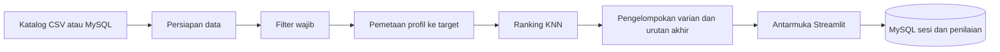

# Metodologi, Data, dan Hasil

Dokumen teknis untuk proyek **Penerapan K-Nearest Neighbors (KNN) pada Content-Based Filtering untuk Sistem Rekomendasi Laptop Berbasis Web**. Dokumen ini bukan naskah jurnal, melainkan catatan yang dapat dipetakan ke bagian-bagian naskah: masalah (bagian 1), data (2), metode (3 sampai 5), hasil (6), keterbatasan (7), etika (8), dan pengembangan (9).

Semua angka dalam dokumen ini berasal dari eksekusi kode di repositori terhadap `dataset/laptops_benchmark_enriched_resolved.csv` (potret katalog 5 Oktober 2026, setelah koreksi data pada bagian 2.3). Pernyataan yang merupakan **asumsi** atau **keputusan desain** ditandai demikian, dan dibedakan dari fakta yang didukung data.

> **Batas klaim.** Dokumen ini tidak mengklaim akurasi. Tidak ada label kebenaran (ground truth), penilaian ahli, maupun evaluasi pengguna yang telah terkumpul. Jarak KNN yang kecil hanya berarti spesifikasi dekat dengan target numerik, bukan bahwa rekomendasinya baik.

## Daftar isi

1. [Masalah dan motivasi](#1-masalah-dan-motivasi)
2. [Data](#2-data)
3. [Arsitektur sistem](#3-arsitektur-sistem)
4. [Metodologi: dari kebutuhan ke ranking](#4-metodologi-dari-kebutuhan-ke-ranking)
5. [Antarmuka dan penyimpanan penilaian](#5-antarmuka-dan-penyimpanan-penilaian)
6. [Evaluasi dan hasil](#6-evaluasi-dan-hasil)
7. [Keterbatasan](#7-keterbatasan)
8. [Etika dan privasi](#8-etika-dan-privasi)
9. [Pengembangan lanjutan](#9-pengembangan-lanjutan)
10. [Reproduksibilitas](#10-reproduksibilitas)
11. [Sumber dan cara mengutip](#11-sumber-dan-cara-mengutip)
12. [Glosarium](#12-glosarium)

## 1. Masalah dan motivasi

Tujuan sistem adalah merekomendasikan laptop berdasarkan **kebutuhan pengguna** (profil penggunaan, budget, batas RAM dan storage), bukan sekadar mencari laptop dengan jarak numerik terkecil.

Versi sebelumnya (v7) membentuk query KNN dari **median CPU dan GPU kandidat yang sudah lolos filter**. Audit terhadap v7 menunjukkan:

| Temuan | Angka |
|---|---|
| Kandidat setelah filter / yang dapat diranking | 127 / 88 |
| Query CPU PassMark dan G3D Mark (median kandidat) | 14.877 dan 3.264 |
| Laptop berjarak persis 0 dari query | 14, dari hanya 32 vektor fitur unik |
| Akibat | Lima rekomendasi hanyalah lima dari 14 hasil seri, terurut menurut urutan baris berkas (arbitrer) |

Penyebab dan masalah terkait:

1. **Median jatuh tepat pada vektor nyata**, sehingga banyak laptop berspesifikasi identik berjarak nol.
2. **Skor G3D beresolusi rendah.** Laptop dengan nama GPU generik berbagi satu skor. Contoh: "Intel Graphics" dimiliki 116 laptop dengan 24 CPU berbeda, semuanya bernilai 3.264. Dari 507 laptop berskor GPU hanya ada 36 nilai G3D unik.
3. **Euclidean simetris menghukum spesifikasi di atas minimum**, karena query RAM dan storage diletakkan di batas minimum.
4. **StandardScaler dipasang pada pool yang sudah difilter**, sehingga bobot fitur berubah antar-query (contoh: simpangan baku RAM pada pool v7 hanya 0,85 GB).
5. **GPU yang berstatus opsional tetap menjadi fitur ranking.** Sebanyak 39 dari 127 kandidat keluar karena skor G3D hilang (20 "AMD Radeon Graphics" generik, 16 "Intel Arc Graphics", 3 Adreno). Pengecualian ini sistematis, bukan acak, dan merugikan laptop dengan iGPU modern.
6. **Harga tidak berperan** dalam ranking; budget dan profil ditulis tetap di kode.

**Kesimpulan audit:** implementasi KNN v7 benar secara matematis. Masalah ada pada desain query, pemetaan kebutuhan, dan kemampuan ranking membedakan kandidat. Karena itu v8 mengganti query berbasis median dengan target eksplisit per profil.

## 2. Data

### 2.1 Sumber dan isi

Katalog laptop **Plaza IT**, 648 laptop, 21 kolom (nama produk, harga, RAM, storage, prosesor dan grafis beserta bentuk normalisasinya, skor PassMark CPU dan G3D, status pemetaan benchmark, URL, tanggal benchmark). Skor benchmark berasal dari **PassMark**. Tanggal benchmark pada seluruh baris adalah 2026-10-05.

| Atribut | Nilai |
|---|---|
| Harga | minimum Rp4.999.000; median Rp16.899.000; maksimum Rp89.100.000 |
| RAM | 16 GB (339 laptop), 8 GB (161), 32 GB (111) |
| Storage | 512 GB (422), 1 TB (170), 256 GB (33) |
| Skor CPU unik / G3D unik | 120 / 36 |

### 2.2 Benchmark yang hilang

| Skor | Status pemetaan | Jumlah |
|---|---|---|
| CPU PassMark | MATCHED / UNMAPPED / AMBIGUOUS | 636 / 7 / 5 |
| GPU G3D Mark | MATCHED / AMBIGUOUS / NO_GPU_DATA | 507 / 94 / 47 |

- **12 laptop tanpa skor CPU** seluruhnya Apple M4 Pro (4), M4 Max (3), dan M5 Pro (5). Harganya Rp33,8 juta ke atas.
- **141 laptop tanpa skor GPU:** 94 bernama GPU generik atau ambigu (AMD Radeon Graphics 52, Intel Arc Graphics 33, Adreno 9) dan 47 laptop Apple (kolom grafis kosong). **Tidak satu pun dari 45 laptop Apple punya skor G3D.**
- **Lengkap pada empat fitur** (RAM, storage, CPU, GPU): 507 laptop.
- **Aturan:** skor yang hilang **tidak** diisi nol dan **tidak** diperkirakan. Jumlah kandidat yang dapat diranking dihitung ulang untuk fitur yang benar-benar dibutuhkan tiap profil.

### 2.3 Koreksi terhadap data sumber

**Skor CPU Apple M3 (11 Oktober 2026).** Pada 7 laptop M3, skor CPU di dataset (14.120) identik dengan skor Apple M1 (14.120), padahal PassMark mencatat M1 sebesar 14.119 dan **M3 sebesar 19.051** (1.602 sampel, per 11 Oktober 2026). Nilai M3 pada dataset diperbaiki menjadi 19.051 langsung pada CSV dan pada tabel MySQL; kolom lain tidak berubah (diverifikasi: tepat 7 sel berbeda dari berkas asli). Penyebabnya diduga skor M1 ikut terpakai pada M3 saat pemetaan (belum dikonfirmasi).

Dampak pada v8: level CPU Rendah bergeser dari 14.643 ke 14.823 dan Sedang dari 18.724 ke 18.871 (Tinggi dan Sangat tinggi tetap); jumlah kandidat per skenario tidak berubah; peringkat teratas berubah pada tiga skenario (office_B, programming_A, programming_B). **Hasil yang dibuat sebelum koreksi memakai nilai lama.**

**Pemeriksaan yang tidak menghasilkan koreksi.** Ryzen AI 7 345 dan Core Ultra 5 125H sama-sama bernilai 19.971 pada dataset. PassMark mencatat 20.096 dan 20.103, keduanya dekat nilai dataset (selisih sekitar 0,7%), sehingga kesamaan itu dianggap kebetulan. Skor CPU Apple lain (A18 Pro, M2, M4, M5, M5 Max) **belum diverifikasi satu per satu**.

### 2.4 Informasi layar dari nama produk

Dataset tidak memiliki kolom layar; informasi hanya tertulis dalam nama produk. Hasil penguraian:

| Informasi | Terbaca |
|---|---|
| Ukuran layar | 645 dari 648 laptop |
| Kelas resolusi | 561 dari 648 (FHD 226, WUXGA 200, QHD/2K 96, 2.5K sampai 3K 35, HD 3, 4K 1); 87 tidak terbaca, termasuk 45 MacBook |
| OLED | 105 laptop (bukti positif saja: tidak tertulis OLED belum berarti bukan OLED) |
| IPS / touchscreen | 79 / 105 |
| Gamut warna (sRGB, DCI-P3) | tidak ada |

## 3. Arsitektur sistem

| Lapisan | Berkas | Tugas |
|---|---|---|
| Data | `dataset/*.csv`, `schema.sql`, `import_catalog.py`, `db.py` | Katalog dan penyimpanan sesi serta penilaian. Benchmark hilang disimpan `NULL`. |
| Inti metode | `knn_v8_profile_recommender.py` | Persiapan data, klasifikasi jenis GPU, parsing layar, filter wajib, target profil, KNN, laptop serupa, laporan evaluasi. |
| Layanan | `service.py` | Validasi input, penyusunan hasil siap tampil, penjelasan rekomendasi. Tanpa dependensi Streamlit atau MySQL. |
| Antarmuka | `streamlit_app.py` | Formulir, hasil, penilaian bintang, tab evaluasi. |

**Keputusan desain:** jenis GPU (`gpu_class`) dan informasi layar **tidak disimpan** di database; keduanya dihitung dari kode saat data dimuat, sehingga aturan hanya ada di satu tempat dan sama antara eksperimen dan aplikasi.

## 4. Metodologi: dari kebutuhan ke ranking

Metodologi memisahkan lima komponen: filter wajib, pemetaan profil ke fitur, ranking KNN, penanganan data hilang, dan evaluasi.

### 4.1 Filter wajib (hard filter)

Kandidat yang tidak memenuhi syarat wajib **tidak pernah dikembalikan**:

- harga kurang dari atau sama dengan budget;
- RAM dan storage kurang dari atau sama dengan nilai yang dipilih pengguna (minimum);
- profil Gaming (dan opsi pengguna): `gpu_class` harus `dedicated`; laptop berkelas `unknown` tidak ikut karena tidak dapat dipastikan;
- filter layar opsional: ukuran minimum, resolusi minimum, hanya OLED (bagian 4.7).

### 4.2 Pemetaan profil ke target

Profil diterjemahkan menjadi **target numerik eksplisit**. Target tidak berasal dari median kandidat.

| Profil | Fitur ranking | RAM rekomendasi | Storage rekomendasi | Level CPU awal | Level GPU awal | GPU dedicated |
|---|---|---|---|---|---|---|
| Office dan kuliah | RAM, storage, CPU | 8 GB | 512 GB | Rendah | tidak dipakai | tidak |
| Programming dan web | RAM, storage, CPU | 16 GB | 512 GB | Sedang | tidak dipakai | tidak |
| Desain dan video | RAM, storage, CPU, GPU | 16 GB | 512 GB | Tinggi | dedicated sedang | opsional |
| Gaming | RAM, storage, CPU, GPU | 16 GB | 512 GB | Tinggi | dedicated sedang | wajib |

- **Target RAM dan storage** = nilai yang lebih tinggi antara minimum pengguna dan rekomendasi profil. Minimum pengguna tetap menjadi filter wajib; rekomendasi profil adalah target lunak.
- **Target CPU** = persentil skor PassMark seluruh katalog yang punya skor CPU (636 laptop), bukan pool terfilter:

| Level | Persentil | Skor |
|---|---|---|
| Rendah | P25 | 14.823 |
| Sedang | P50 | 18.871 |
| Tinggi | P75 | 24.969 |
| Sangat tinggi | P90 | 34.222 |

- **Target GPU** = persentil atas **model GPU unik** (bukan atas laptop, agar tidak ditentukan stok toko), per kelas GPU:

| Level | Populasi | Persentil | Skor G3D |
|---|---|---|---|
| iGPU memadai | model iGPU berskor | P75 | 6.186 |
| dedicated rendah | model dedicated | P25 | 12.352 |
| dedicated sedang | model dedicated | P50 | 17.042 |
| dedicated tinggi | model dedicated | P75 | 23.039 |
| dedicated sangat tinggi | model dedicated | P90 | 26.656 |

> **Asumsi operasional.** Persentil katalog, level bawaan tiap profil, dan rekomendasi RAM atau storage adalah **asumsi** yang perlu diuji, bukan standar industri. Nilainya relatif terhadap katalog Plaza IT pada 5 Oktober 2026 dan berubah bila katalog berubah. Profil Office dan Programming memakai fitur yang sama dan hanya berbeda pada target; perbedaan itu belum divalidasi.

### 4.3 Ranking KNN

Fitur distandardisasi dengan `StandardScaler` yang dipasang pada **populasi referensi tetap** (seluruh katalog yang lengkap pada fitur profil itu), **bukan** pada pool terfilter, sehingga bobot fitur stabil antar-query. Untuk kandidat `c`, target `t`, dan fitur `j`:

$$\Delta_j = z_j(c) - z_j(t), \qquad \Delta'_j = \begin{cases}\sqrt{\lambda}\,\Delta_j & \Delta_j > 0 \\ \Delta_j & \Delta_j \le 0\end{cases}, \qquad d(c,t) = \sqrt{\sum_j {\Delta'_j}^2}$$

Selisih di bawah target berbobot penuh; selisih di atas target dikalikan $\sqrt{\lambda}$ dengan $\lambda = 0{,}25$ (keputusan desain). $\lambda = 1$ adalah jarak Euclidean simetris biasa, dan $\lambda = 0$ mengabaikan kelebihan. Perhitungan memakai `NearestNeighbors` (scikit-learn, metrik Euclidean) pada ruang yang telah diubah per query.

- **Konsekuensi.** Spesifikasi di atas target tidak dihukum berat, sehingga pada profil hemat laptop yang jauh lebih kuat tetapi kebetulan murah dapat naik peringkat. Bobot semua fitur sama (asumsi).
- **Aturan seri.** Jarak dibulatkan pada $10^{-9}$; jika sama, urutkan harga terendah, lalu urutan baris.
- **Pengelompokan varian.** Laptop dengan vektor fitur identik (pada fitur profil) dikelompokkan; satu perwakilan, yaitu yang termurah, ditampilkan, dan varian lain tetap tercatat di `knn_v8_full_ranking.csv`. Konsekuensinya, perbedaan yang tidak ada di fitur (layar, baterai, garansi, merek) tidak dinilai.
- **Alternatif yang tidak dipilih:** cosine (membuang informasi besaran), MinMax (peka terhadap pencilan; CPU maksimum 62.164), Mahalanobis (memperhitungkan korelasi CPU dan GPU sebesar 0,81 tetapi sulit dijelaskan kepada pengguna), dan transformasi log pada benchmark yang miring.

### 4.4 Peran harga

Harga **bukan fitur KNN**. Harga berkorelasi 0,75 sampai 0,80 dengan semua fitur lain; memasukkannya hanya menarik ranking ke arah termurah. Harga dipakai pada tiga tempat: batas wajib (budget), pemutus seri, dan informasi tampilan.

### 4.5 Data hilang dan GPU opsional

- Tidak ada imputasi. Kandidat yang lolos filter wajib tetapi tidak punya skor yang dibutuhkan profil dikeluarkan dari ranking dan **dilaporkan** (jumlah dan alasan) di `knn_v8_unrankable_candidates.csv` dan di antarmuka.
- Pada Office dan Programming, GPU **tidak dipakai** dalam ranking, sehingga laptop Apple dan laptop dengan iGPU generik tetap dapat diranking. Konsekuensinya: laptop ber-GPU kuat dapat muncul berdampingan dengan laptop iGPU yang CPU-nya setara.
- Pada Desain dan Gaming, skor GPU wajib; laptop tanpa skor tidak diberi nilai nol, melainkan dilaporkan sebagai tidak dapat diranking.

### 4.6 Klasifikasi jenis GPU

Jenis GPU (`dedicated`, `integrated`, `unknown`) berbeda dari tingkat performa (skor G3D). Contoh yang menunjukkan perbedaan itu: Radeon 8060S adalah GPU terintegrasi dengan skor G3D 18.057, lebih tinggi daripada RTX 4060 Laptop (17.326) pada dataset ini. Karena itu ambang skor tidak dipakai untuk menentukan jenis.

Aturan berurutan (di `classify_gpu`):

| Aturan | Hasil |
|---|---|
| Kolom grafis kosong dan CPU Apple A/M-series | integrated (GPU menyatu pada SoC) |
| Kolom grafis kosong, bukan Apple | unknown |
| Nama produk menyebut RTX/GTX/Radeon RX tetapi kolom grafis tidak | unknown (konflik) |
| Nama memuat GeForce, RTX, GTX, Radeon RX, Radeon Pro, Quadro, atau Arc seri A | dedicated |
| Intel Arc B390 dengan CPU Core Ultra X | integrated |
| Intel UHD, Iris Xe, "Intel Graphics", Adreno | integrated |
| Intel Arc seri V dan T (mis. 140V) | integrated |
| Radeon seri M (mis. 680M, 780M) dan 8060S | integrated |
| "AMD Radeon Graphics" dengan CPU Ryzen atau Athlon | integrated (aturan pasangan) |
| "Intel Arc Graphics" dengan CPU Core Ultra | integrated (aturan pasangan) |
| Lainnya | unknown |

**Hasil pada 648 laptop:** dedicated 168, integrated 477, unknown 3 (dua laptop non-Apple tanpa kolom grafis dan satu laptop yang nama produknya menyebut RTX tetapi kolom grafisnya Intel Arc).

**Validasi ke sumber** (cakupan jujur): 12 dari 78 nama GPU pada `inspection/knn_v8_gpu_classification_audit.csv`, yang mencakup 299 dari 648 laptop, divalidasi ke sumber tepercaya (bagian 11): aturan pasangan untuk nama generik AMD dan Intel, Intel Arc B390, Radeon 8060S, GeForce MX570A, "Intel Graphics", Intel Iris Xe, serta Radeon 840M dan 680M. Sebanyak 66 nama (349 laptop) **belum divalidasi satu per satu**; yang terbesar adalah Intel UHD Graphics (65 laptop), nama GPU NVIDIA RTX (164 laptop; risikonya kecil karena semuanya kartu terpisah, tetapi belum dicek per model), dan Apple (45, diklasifikasikan sebagai SoC). Status tiap nama ada pada kolom `validation_status` berkas audit.

### 4.7 Fitur layar

Layar adalah **tampilan dan filter opsional, bukan fitur KNN** (keputusan desain: menjadikannya fitur memerlukan target resolusi, yaitu satu asumsi tambahan, dan data kualitas warna tidak tersedia).

- Filter: ukuran minimum, resolusi minimum (HD, FHD, WUXGA, QHD/2K, 2.5K sampai 3K, 4K), dan hanya OLED.
- Informasi yang tidak tertulis **tidak ditebak**: bila filter ukuran atau resolusi dipakai, laptop yang informasinya tidak tertulis dikeluarkan dan dilaporkan sebagai tidak dapat dipastikan (misalnya MacBook, yang namanya tidak menyebut resolusi).
- Filter OLED hanya mengenali laptop yang menuliskan OLED pada nama produk.
- Sistem **tidak** menjamin akurasi warna untuk desain; hanya resolusi dan OLED yang tertulis pada data.

### 4.8 Laptop serupa (KNN antar-laptop)

Mencari laptop dengan spesifikasi terdekat dari satu laptop acuan, memakai fitur profil yang sama:

- query adalah vektor fitur laptop acuan (bukan target profil), jarak Euclidean simetris ($\lambda = 1$), karena yang diukur adalah kemiripan, bukan pencapaian target;
- **budget tidak diberlakukan** (keputusan pengguna); laptop yang melampaui budget diberi tanda. RAM minimum, storage minimum, syarat dedicated (bila wajib), dan filter layar tetap berlaku;
- laptop yang identik dengan acuan pada fitur profil dilaporkan sebagai varian, bukan tetangga;
- bila laptop acuan tidak punya skor yang dibutuhkan profil, sistem memberi pesan, bukan hasil.

### 4.9 Penjelasan rekomendasi

Kalimat "Mengapa direkomendasikan?" dirangkai **hanya dari angka yang dipakai ranking**: posisi tiap fitur terhadap target, posisi harga terhadap kandidat lain, informasi layar, catatan GPU bila GPU tidak dipakai, dan peringkat. Penjelasan tidak membuat klaim tentang mutu laptop. Setiap angka pada kalimat diverifikasi ulang terhadap data pada pengujian.

## 5. Antarmuka dan penyimpanan penilaian

Aplikasi menyimpan, **anonim**, setiap pencarian (profil, budget, batas RAM dan storage, level, jumlah kandidat) dan setiap penilaian bintang 1 sampai 5 per rekomendasi. Tabel: `sessions`, `session_items`, `feedback` (dan `laptops` untuk katalog). Penyimpanan hanya terjadi bila MySQL aktif dan pengguna mencentang persetujuan. Filter layar dan pencarian "mirip" tidak dicatat. Tab **Evaluasi pengguna** menampilkan jumlah sesi dan penilaian, rata-rata rating per profil dan **per peringkat**, serta ekspor CSV. Jika rating peringkat 1 rata-rata lebih tinggi daripada peringkat 5, urutan ranking sejalan dengan penilaian pengguna; bila datar, ranking belum membedakan laptop yang cocok dari yang kurang cocok.

## 6. Evaluasi dan hasil

### 6.1 Apa yang diukur

Diukur: kepatuhan constraint, keragaman vektor fitur, jumlah kandidat per tahap, kandidat yang keluar karena benchmark hilang, dan sensitivitas ranking terhadap asumsi. **Tidak diukur:** akurasi atau relevansi menurut manusia (tidak ada ground truth).

### 6.2 Delapan skenario uji

Dua skenario per profil, dengan batas yang dipilih sebagai ilustrasi (bukan rekomendasi). Skenario `programming_A` memakai budget, RAM, dan storage yang sama dengan profil uji v7.

| Skenario | Budget | RAM min | Storage min | Lolos filter dasar | Lolos syarat GPU | Dapat diranking | Belum dapat diranking | Vektor unik (dapat diranking) |
|---|---|---|---|---|---|---|---|---|
| office_A | 10.000.000 | 8 | 256 | 105 | 105 | 105 | 0 | 40 |
| office_B | 15.000.000 | 8 | 512 | 242 | 242 | 242 | 0 | 76 |
| programming_A | 14.999.994 | 16 | 512 | 127 | 127 | 127 | 0 | 41 |
| programming_B | 20.000.000 | 16 | 512 | 247 | 247 | 247 | 0 | 78 |
| design_A | 25.000.000 | 16 | 512 | 325 | 325 | 252 | 73 | 109 |
| design_B | 35.000.000 | 32 | 1024 | 52 | 52 | 45 | 7 | 24 |
| gaming_A | 20.000.000 | 16 | 512 | 247 | 40 | 40 | 0 | 27 |
| gaming_B | 30.000.000 | 16 | 1024 | 94 | 24 | 24 | 0 | 21 |

Catatan pembacaan: pada Gaming, kandidat terintegrasi (207 pada gaming_A, 69 pada gaming_B) keluar karena syarat dedicated, bukan karena benchmark hilang. Pada Desain, kandidat yang tidak dapat diranking (73 dan 7) adalah laptop tanpa skor GPU (Apple dan iGPU generik). Pada profil v7 (programming_A), pool yang dapat diranking naik dari 88 menjadi 127 karena GPU tidak dipakai; namun hanya 41 vektor unik, sehingga penanganan seri dan pengelompokan varian tetap dibutuhkan.

### 6.3 Pemeriksaan constraint dan keragaman

- Seluruh rekomendasi pada kedelapan skenario memenuhi budget, RAM minimum, storage minimum, dan (Gaming) syarat dedicated.
- Tidak ada vektor fitur duplikat di antara rekomendasi (berbeda dari v7).
- Kedekatan terhadap target berbeda antar skenario. Persentase kandidat yang mencapai **semua** target:

| Skenario | office_A | office_B | programming_A | programming_B | design_A | design_B | gaming_A | gaming_B |
|---|---|---|---|---|---|---|---|---|
| Kandidat mencapai semua target | 15,2% | 54,5% | 28,3% | 40,9% | 1,6% | 6,7% | 2,5% | 41,7% |
| Rekomendasi (dari 5) di bawah target pada minimal satu fitur | 0 | 0 | 1 | 1 | 5 | 3 | 4 | 3 |

Pada budget yang membuat target hampir tidak tercapai (mis. design_A dan gaming_A), jarak yang besar **tidak** berarti rekomendasinya buruk; ranking menjadi "terdekat dari bawah", dan antarmuka menampilkan persen di bawah target per fitur agar hal itu terbaca.

### 6.4 Sensitivitas

Tumpang tindih Jaccard antara himpunan vektor top-5 baseline dan top-5 setelah satu asumsi diubah (1,00 = identik; 0,00 = tidak ada yang sama). Karena hanya lima item, nilai Jaccard berloncatan (0,00; 0,11; 0,25; 0,43; 0,67; 1,00).

| Skenario | $\lambda=1$ | $\lambda=0$ | Level CPU turun | Level CPU naik | Level GPU turun | Level GPU naik |
|---|---|---|---|---|---|---|
| office_A | 0,43 | 0,43 | n/a | 0,25 | n/a | n/a |
| office_B | 0,43 | 0,11 | n/a | 0,00 | n/a | n/a |
| programming_A | 0,67 | 0,25 | 0,00 | 0,00 | n/a | n/a |
| programming_B | 0,67 | 0,11 | 0,00 | 0,00 | n/a | n/a |
| design_A | 1,00 | 0,00 | 0,67 | 0,00 | 0,00 | 0,43 |
| design_B | 0,67 | 0,67 | 0,67 | 0,43 | 0,43 | 0,67 |
| gaming_A | 0,67 | 0,67 | 0,43 | 0,25 | 0,11 | 0,67 |
| gaming_B | 0,67 | 0,11 | 0,67 | 0,25 | 0,43 | 0,67 |

`n/a`: level tidak ada di arah itu (mis. Rendah tidak punya level lebih rendah) atau GPU tidak dipakai.

**Temuan:** ranking sangat sensitif terhadap level target; pada sebagian skenario, menggeser level CPU satu tingkat mengganti seluruh top-5. Nilai $\lambda$ juga berpengaruh. Akibatnya level preferensi dibuat dapat diatur pengguna, dan nilai bawaannya perlu diuji dengan penilaian manusia, bukan dianggap benar.

**Koreksi default Gaming.** Level GPU bawaan Gaming semula dedicated tinggi (G3D 23.039), yang tidak dicapai kandidat mana pun pada budget uji (jarak 0,8 sampai 1,2 menyesatkan). Bawaan diubah ke dedicated sedang (jarak 0,20 sampai 0,40 pada gaming_A). Pilihan ini tetap asumsi.

**Pengamatan lain:** pada Desain, top-5 didominasi laptop gaming karena profil hanya mengukur CPU dan GPU; pada Programming, GPU yang tidak dipakai membuat laptop RTX dapat muncul.

### 6.5 Evaluasi oleh manusia (belum dilaksanakan)

- **Alat evaluasi ahli** (`knn_v8_expert_eval.py`): lembar penilaian buta (penilai tidak melihat metode, peringkat, jarak, atau skor) yang mencampur empat sumber item, yaitu top-5 v8, top-5 v8 simetris ($\lambda=1$), 5 laptop termurah, dan 5 laptop acak, dinilai 1 sampai 5. Skrip menghitung rata-rata per metode, selisih dengan interval bootstrap, korelasi rank, dan kesepakatan antar-penilai (quadratic weighted kappa). Alat ini diuji dengan penilai sintetis dan **belum dipakai pada penilai nyata**.
- **Penilaian pengguna** melalui aplikasi (bagian 5). **Belum ada data penilaian nyata yang terkumpul.**

## 7. Keterbatasan

1. Kualitas rekomendasi **belum divalidasi** oleh ahli maupun pengguna; tidak ada ground truth.
2. Persentil target, level bawaan, rekomendasi RAM atau storage, $\lambda = 0{,}25$, dan bobot fitur yang sama adalah **asumsi**; ranking sangat sensitif terhadapnya (bagian 6.4).
3. Skor G3D beresolusi rendah: nama GPU generik berbagi satu skor, sehingga G3D untuk iGPU tidak membedakan laptop dengan baik. Karena itu GPU tidak dipakai pada Office dan Programming secara bawaan.
4. Klasifikasi jenis GPU baru divalidasi sebagian (12 dari 78 nama).
5. Kesebandingan skor PassMark CPU Apple dan x86 adalah asumsi. Laptop Apple tanpa skor CPU (M4 Pro, M4 Max, M5 Pro) dan semua laptop Apple pada profil yang memerlukan G3D tidak dapat diranking.
6. Skor CPU baru di PassMark dapat berasal dari sedikit sampel (contoh: Ryzen AI 7 345 hanya 5 sampel pada 11 Oktober 2026), dan skor berubah dari hari ke hari.
7. Informasi layar hanya dari nama produk; OLED adalah bukti positif saja; gamut warna tidak tersedia; profil Desain tidak memodelkan kualitas layar.
8. Office dan Programming memakai fitur yang sama dan hanya berbeda pada target.
9. Data berasal dari satu toko pada satu tanggal; harga dan stok dapat berubah, dan hasil tidak berlaku umum.
10. Penilaian pengguna dipilih sendiri oleh responden dan jumlahnya kecil, sehingga hanya indikatif.
11. Pengelompokan varian menyembunyikan perbedaan yang tidak ada di fitur (layar, baterai, garansi, merek).

## 8. Etika dan privasi

- Penilaian dan kriteria pencarian disimpan **anonim**: tidak ada nama, email, atau alamat IP. Penyimpanan memerlukan persetujuan pengguna melalui kotak centang pada formulir.
- Kolom komentar bebas bersifat opsional; pengguna diminta tidak menuliskan data pribadi.
- Tab **Evaluasi pengguna** menampilkan ringkasan dan ekspor tanpa autentikasi. Jika aplikasi dipublikasikan, akses tab itu perlu dibatasi.
- Kredensial database disimpan di `.streamlit/secrets.toml` yang tidak ikut Git.

## 9. Pengembangan lanjutan

- Memvalidasi 66 nama GPU yang tersisa ke sumber produsen, dan memeriksa skor CPU Apple satu per satu.
- Memetakan skor G3D iGPU per CPU (bukan per nama generik) agar GPU terintegrasi dapat dibedakan.
- Melaksanakan evaluasi ahli dan mengumpulkan penilaian pengguna, termasuk uji A/B tersembunyi terhadap pembanding sederhana.
- Menguji level persentil bawaan dan nilai $\lambda$ dengan penilaian manusia.
- Menjadikan layar sebagai fitur ranking bila ada data kualitas layar yang andal (resolusi, gamut) dan target yang dapat dipertanggungjawabkan.
- Mencatat filter layar dan pencarian "mirip" untuk analisis; penerapan di server yang dapat dijangkau responden.

## 10. Reproduksibilitas

- **Lingkungan:** aplikasi dijalankan pada Windows dengan Python 3.13 dan MySQL; logika inti juga diuji pada Linux dengan Python 3.12. Versi paket minimum ada di `requirements.txt` (`streamlit>=1.40`, `pymysql>=1.1`, `cryptography>=42`, `pandas>=2.0`, `numpy>=1.24`, `scikit-learn>=1.3`).
- **Deterministik:** perhitungan rekomendasi tidak memakai bilangan acak, dan aturan seri tetap (bagian 4.3). Satu-satunya pengacakan ada pada alat evaluasi ahli, dengan benih tetap 2026.
- **Langkah:**
  1. Siapkan lingkungan seperti pada README.
  2. Jalankan `python knn_v8_profile_recommender.py`.
  3. Bandingkan `inspection/knn_v8_scenario_summary.csv` dengan tabel pada bagian 6.2.
- **Versi data:** hasil bergantung pada potret katalog 5 Oktober 2026 **setelah** koreksi skor M3 (bagian 2.3). Hasil sebelum koreksi berbeda (level CPU dan beberapa top-5).

## 11. Sumber dan cara mengutip

**Cara mengutip repositori** (lengkapi nama penulis sesuai kebutuhan):

> *Sistem Rekomendasi Laptop Berbasis KNN: Penerapan K-Nearest Neighbors pada Content-Based Filtering untuk Sistem Rekomendasi Laptop Berbasis Web.* Repositori GitHub, 2026. https://github.com/glngprr/laptop-recommendation-app

**Data:** katalog Plaza IT (potret 5 Oktober 2026) dan skor benchmark PassMark (CPU Mark dan G3D Mark).

**Sumber validasi** yang dibuka untuk koreksi data dan klasifikasi GPU (diakses 11 sampai 12 Oktober 2026):

- PassMark, Apple M3 8 Core: https://www.cpubenchmark.net/compare/5749vs5266/Apple-M3-8-Core-vs-Intel-Core-i7-1365U
- PassMark, Apple M1 8 Core 3200 MHz dan Iris Xe pada i7-1165G7: https://www.cpubenchmark.net/compare/4104vs3814/Apple-M1-8-3200-MHz-vs-Intel-i7-1165G7
- PassMark, Ryzen AI 7 345 (dengan Radeon 840M) dan Core Ultra 5 125U: https://www.cpubenchmark.net/compare/7383vs5840/AMD-Ryzen-AI-7-345-vs-Intel-Ultra-5-125U
- PassMark, Ryzen AI 7 PRO 350 dan Core Ultra 5 125H: https://www.cpubenchmark.net/compare/6513vs5777/AMD-Ryzen-AI-7-PRO-350-vs-Intel-Ultra-5-125H
- Notebookcheck, Core Ultra 5 125H dan 7 155H (iGPU Intel Arc): https://www.notebookcheck.com/Ultra-5-125H-vs-Ultra-7-155H_16911_16906.247552.0.html
- Notebookcheck, Ryzen 7 7735HS (iGPU Radeon 680M): https://www.notebookcheck.net/R7-7735HS-vs-R7-7730U_14952_14956.247596.0.html
- Notebookcheck, GeForce MX570: https://www.notebookcheck.net/NVIDIA-GeForce-MX570-GPU-Benchmarks-and-Specs.586934.0.html
- Intel ARK, Core Ultra X7 358H (Intel Arc B390): https://www.intel.com/content/www/us/en/products/sku/245527/intel-core-ultra-x7-processor-358h-18m-cache-up-to-4-80-ghz/specifications.html
- Notebookcheck, Ryzen AI Max+ 395 (Radeon 8060S): https://www.notebookcheck.net/AMD-Ryzen-AI-Max-395-Processor-Benchmarks-and-Specs.942323.0.html

## 12. Glosarium

| Istilah | Arti |
|---|---|
| Content-based filtering | Merekomendasikan item berdasarkan kemiripan atribut item dengan kebutuhan atau profil, bukan berdasarkan perilaku pengguna lain |
| KNN (K-Nearest Neighbors) | Mencari K item dengan jarak terdekat terhadap sebuah query pada ruang fitur |
| PassMark CPU Mark / G3D Mark | Skor benchmark prosesor dan kartu grafis dari PassMark; makin tinggi makin cepat menurut benchmark tersebut |
| iGPU / dGPU | GPU terintegrasi pada prosesor / kartu grafis terpisah dengan memori sendiri |
| Standardisasi (z-score) | Mengubah fitur menjadi $(x-\mu)/\sigma$ agar skala tiap fitur sebanding |
| Persentil | Nilai di bawah yang terdapat sejumlah persen data |
| Imputasi | Mengisi nilai yang hilang dengan perkiraan; **tidak dilakukan** pada proyek ini |
| Jaccard | Ukuran tumpang tindih dua himpunan: ukuran irisan dibagi ukuran gabungan |
| QWK | Quadratic weighted kappa, ukuran kesepakatan antar-penilai pada skala berurutan |
| Ground truth | Label kebenaran yang diakui; tidak tersedia pada proyek ini |
