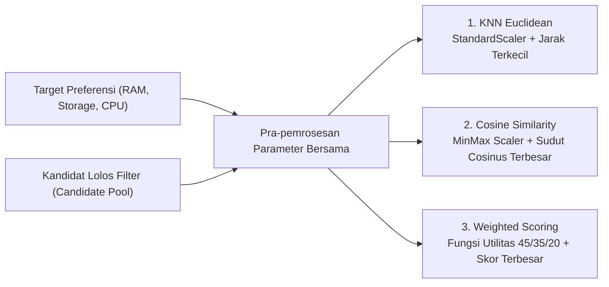
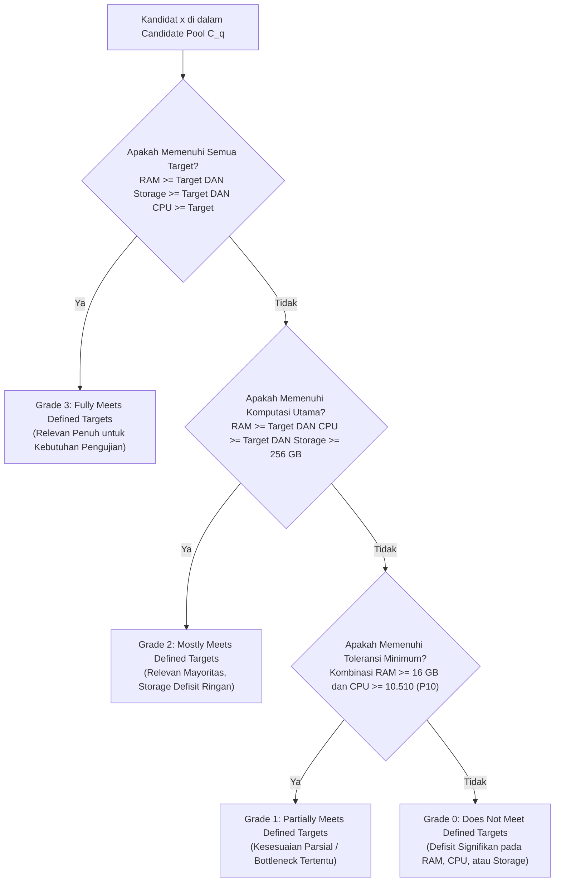
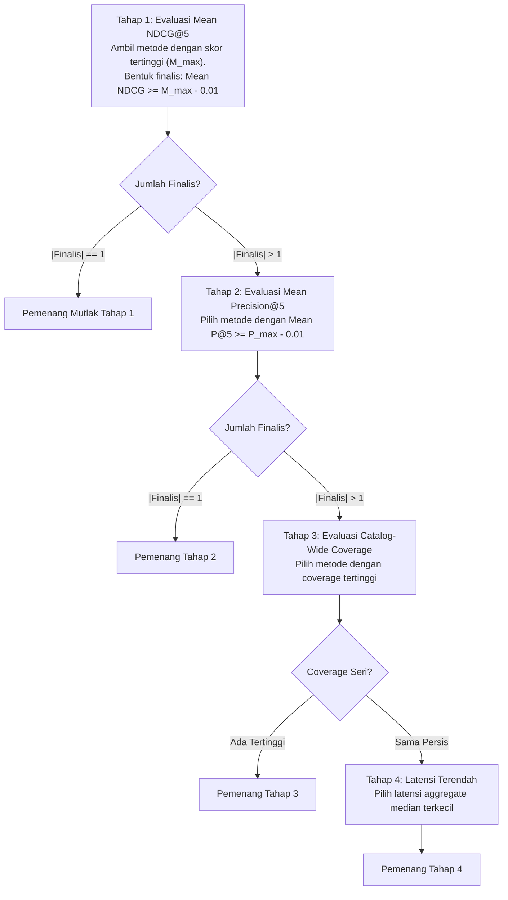
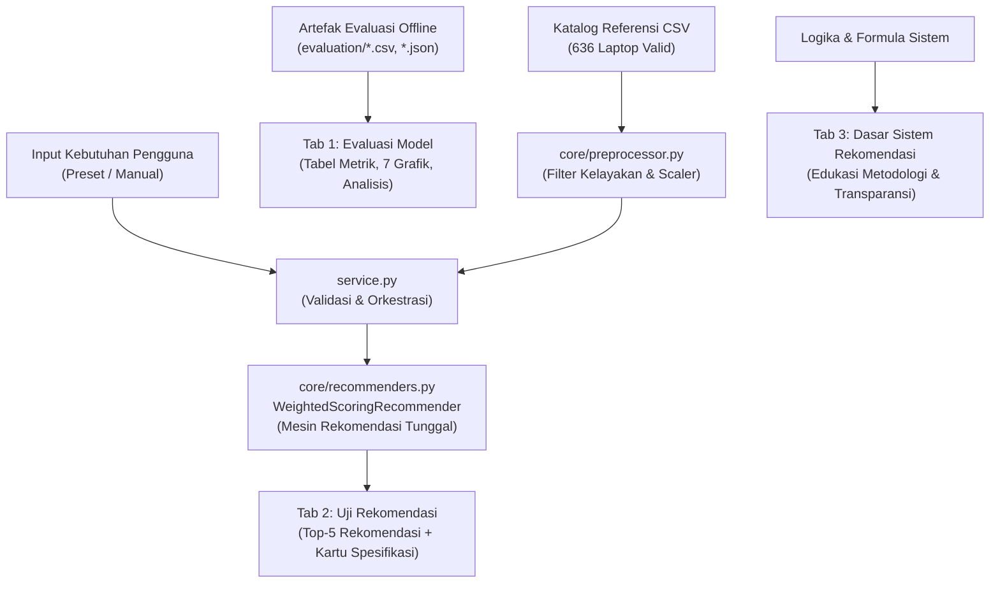

# PANDUAN KOMPREHENSIF PRESENTASI PENELITIAN
# SISTEM REKOMENDASI LAPTOP UNTUK PENGEMBANGAN APLIKASI ANDROID

**Judul Penelitian:** Perbandingan Metode Sistem Rekomendasi Laptop untuk Android Developer  
**Judul Lengkap:** Perbandingan Metode K-Nearest Neighbors, Cosine Similarity, dan Weighted Scoring pada Sistem Rekomendasi Laptop Berdasarkan Kebutuhan Hardware untuk Android Developer
**Domain Studi:** Sistem Pendukung Keputusan (*Decision Support System*) & *Content-Based Filtering*  
**Tumpukan Teknologi:** Python, Streamlit, Pandas, NumPy, Scikit-learn (Arsitektur Bebas Database / *Zero-Database*)  
**Dokumen Acuan:** `docs/EVALUATION_SPEC.md` Versi 2.1.0  
**Status Evaluasi:** Terverifikasi dan Terkunci (*Accepted Benchmark*)  

---

## DAFTAR ISI

- [BAB I — PENDAHULUAN](#bab-i--pendahuluan)
  - [1.1 Latar Belakang Masalah](#11-latar-belakang-masalah)
  - [1.2 Identifikasi Masalah](#12-identifikasi-masalah)
  - [1.3 Rumusan Masalah](#13-rumusan-masalah)
  - [1.4 Tujuan Penelitian](#14-tujuan-penelitian)
  - [1.5 Manfaat Penelitian](#15-manfaat-penelitian)
  - [1.6 Batasan Penelitian](#16-batasan-penelitian)
- [BAB II — DATASET DAN SISTEM REKOMENDASI](#bab-ii--dataset-dan-sistem-rekomendasi)
  - [2.1 Karakteristik dan Validasi Dataset](#21-karakteristik-dan-validasi-dataset)
  - [2.2 Pra-pemrosesan dan Penyaringan Kelayakan Kandidat](#22-pra-pemrosesan-dan-penyaringan-kelayakan-kandidat)
  - [2.3 Pemetaan Kebutuhan dan Profil Beban Kerja Android](#23-pemetaan-kebutuhan-dan-profil-beban-kerja-android)
  - [2.4 Formulasi Tiga Metode Rekomendasi](#24-formulasi-tiga-metode-rekomendasi)
- [BAB III — METODOLOGI EVALUASI KOMPARATIF](#bab-iii--metodologi-evaluasi-komparatif)
  - [3.1 Desain Eksperimen Evaluasi Offline](#31-desain-eksperimen-evaluasi-offline)
  - [3.2 Pembentukan Ground Truth dan Skala Relevansi Heuristik](#32-pembentukan-ground-truth-dan-skala-relevansi-heuristik)
  - [3.3 Metrik Evaluasi Komparatif](#33-metrik-evaluasi-komparatif)
  - [3.4 Prosedur Pemilihan Metode Pemenang](#34-prosedur-pemilihan-metode-pemenang)
- [BAB IV — HASIL DAN PEMBAHASAN](#bab-iv--hasil-dan-pembahasan)
  - [4.1 Ringkasan Data Hasil Pengujian](#41-ringkasan-data-hasil-pengujian)
  - [4.2 Analisis Komparatif Performa Metode](#42-analisis-komparatif-performa-metode)
  - [4.3 Analisis Kemenangan Metode Skor Berbobot](#43-analisis-kemenangan-metode-skor-berbobot)
  - [4.4 Interpretasi dan Implikasi Penelitian](#44-interpretasi-dan-implikasi-penelitian)
  - [4.5 Evaluasi Keterbatasan dan Ancaman Validitas](#45-evaluasi-keterbatasan-dan-ancaman-validitas)
- [BAB V — IMPLEMENTASI DAN KESIMPULAN](#bab-v--implementasi-dan-kesimpulan)
  - [5.1 Implementasi Perangkat Lunak](#51-implementasi-perangkat-lunak)
  - [5.2 Kesimpulan Penelitian](#52-kesimpulan-penelitian)
  - [5.3 Saran Pengembangan Lanjutan](#53-saran-pengembangan-lanjutan)

---

## BAB I — PENDAHULUAN

### 1.1 Latar Belakang Masalah

Pengembangan aplikasi Android modern menuntut kapabilitas komputasi perangkat keras yang spesifik dan intensif. Lingkungan pengembangan terintegrasi (*Integrated Development Environment* / IDE) utama, yaitu Android Studio, beroperasi di atas mesin virtual Java (*Java Virtual Machine* / JVM) dan secara berkala menjalankan proses kompilasi kode sumber melalui Gradle build system. Proses kompilasi kode sumber Kotlin maupun Java, pembuatan file paket aplikasi (APK/AAB), dan pengindeksan basis kode berskala besar mengonsumsi memori dan komputasi prosesor secara simultan. Di samping IDE, alur kerja pengembang aplikasi Android lazim melibatkan emulator Android (*Android Virtual Device* / AVD) lokal untuk menguji perilaku aplikasi pada berbagai versi sistem operasi dan resolusi layar. AVD mengalokasikan memori RAM fisik tersendiri dan memanfaatkan virtualisasi perangkat keras langsung dari CPU komputer induk.

Kebutuhan sumber daya komputasi tersebut memicu permasalahan nyata bagi calon pembeli laptop, khususnya kalangan mahasiswa, praktisi pemula, maupun pengembang profesional:

1. **Kompleksitas Spesifikasi Perangkat Keras:** Di pasar komputer jinjing (*laptop*), terdapat ratusan variasi produk dengan rentang harga yang tumpang tindih. Dua laptop dengan tingkat harga yang sama dapat memiliki konfigurasi prosesor, kapasitas RAM, dan arsitektur penyimpanan yang sangat kontras.
2. **Keterbatasan Evaluasi Parsial:** Membandingkan laptop hanya berdasarkan satu parameter (misalnya harga semata atau kapasitas penyimpanan saja) kerap menghasilkan keputusan yang keliru. Laptop berharga murah dapat mengalami kendala penurunan kecepatan parah (*disk paging* atau *thrashing*) apabila RAM yang tersedia tidak mencukupi untuk menjalankan Android Studio bersamaan dengan emulator. Sebaliknya, laptop dengan kartu grafis diskret bertenaga tinggi belum tentu optimal untuk pengembangan aplikasi Android apabila kapasitas memori dasarnya terbatas.
3. **Information Overload pada Katalog Elektronik:** Calon pembeli dihadapkan pada katalog toko komputer yang menyajikan ratusan item spesifikasi teknis dalam format teks bebas tanpa alat bantu seleksi yang kontekstual terhadap beban kerja rekayasa perangkat lunak.

Sistem Rekomendasi (*Recommender System*) berbasis *Content-Based Filtering* (CBF) menawarkan solusi terstruktur untuk memetakan profil kebutuhan perangkat keras pengguna ke dalam ruang spesifikasi laptop yang relevan. Namun demikian, dalam literatur dan rekayasa perangkat lunak, sistem rekomendasi berbasis konten sering kali dibangun langsung menggunakan satu metode tertentu (misalnya *K-Nearest Neighbors*) tanpa adanya pengujian komparatif empiris apriori untuk membuktikan apakah fungsi kedekatan metrik yang digunakan memang paling tepat untuk karakteristik domain pemilihan perangkat keras.

Penelitian ini dirancang untuk menjawab kesenjangan tersebut melalui studi komparatif offline secara sistematis terhadap tiga metode rekomendasi berbasis konten:
1. **KNN-based Euclidean Ranking** (pemeringkatan ketetanggaan terdekat berbasis jarak Euclidean terstandarisasi);
2. **Cosine Similarity** (pengukuran kemiripan sudut arah rasio fitur dalam ruang bernormalisasi); dan
3. **Weighted Scoring** (*Multi-Attribute Utility Theory* / MAUT, pemeringkatan utilitas terbobot dengan apresiasi kelebihan spesifikasi).

Hasil studi komparatif ini menjadi landasan ilmiah objektif dalam menentukan satu metode terbaik (*single winning method*) yang diintegrasikan ke dalam antarmuka aplikasi sistem pendukung keputusan.

### 1.2 Identifikasi Masalah

Berdasarkan latar belakang di atas, diidentifikasi beberapa permasalahan spesifik:
1. Calon pembeli laptop untuk pengembangan aplikasi Android kesulitan menyaring dan memeringkatkan ratusan varian laptop pada katalog toko komputer secara akurat dan efisien.
2. Karakteristik algoritma rekomendasi berbasis jarak (*distance-based metric*) seperti KNN Euclidean menganggap spesifikasi yang melampaui target kebutuhan sebagai "jarak yang menjauhi target" (*overspecification penalty*), yang berpotensi menurunkan peringkat laptop berspesifikasi lebih unggul.
3. Metode Cosine Similarity hanya mengukur kesamaan proporsi atau arah vektor atribut, sehingga berisiko menyamakan laptop berspesifikasi rendah dengan laptop berspesifikasi tinggi selama rasio antar-atributnya proporsional.
4. Diperlukan pembuktian empiris yang terukur menggunakan metrik temu balik informasi (*Information Retrieval metrics*) standar (NDCG, Precision, Recall, Coverage, dan Latensi) untuk membandingkan performa pemeringkatan ketiga metode tersebut pada skenario pengujian terkontrol.

### 1.3 Rumusan Masalah

Rumusan masalah yang dijawab dalam penelitian ini adalah:
1. Bagaimana memodelkan dan menerapkan metode KNN Euclidean, Cosine Similarity, dan Weighted Scoring ke dalam sistem rekomendasi pemilihan laptop untuk beban kerja pengembangan aplikasi Android?
2. Bagaimana perbandingan performa pemeringkatan ketiga metode rekomendasi tersebut berdasarkan metrik Mean NDCG@5, Mean Precision@5, Mean Recall@5, Catalog-Wide Coverage, dan Latensi Komputasi pada skenario pengujian terkontrol?
3. Metode rekomendasi manakah yang menghasilkan performa pemeringkatan terbaik berdasarkan protokol seleksi pemenang bertingkat apriori terhadap kriteria relevansi heuristik yang ditetapkan?

### 1.4 Tujuan Penelitian

Tujuan dari penelitian ini meliputi:
1. Mengimplementasikan algoritma KNN Euclidean, Cosine Similarity, dan Weighted Scoring secara mandiri dan modular dengan pra-pemrosesan parameter bersama.
2. Mengevaluasi performa ketiga metode secara objektif pada 72 skenario pengujian terkontrol menggunakan metrik Mean NDCG@5, Mean Precision@5, Mean Recall@5, Catalog Coverage, dan Latensi.
3. Menentukan satu metode pemenang secara formal melalui prosedur hierarkis 4 tahap untuk diintegrasikan sebagai mesin rekomendasi aktif pada aplikasi berbasis web Streamlit.

### 1.5 Manfaat Penelitian

- **Manfaat Teoretis / Akademis:** Memberikan kontribusi empiris mengenai perilaku komparatif metrik jarak Euclidean, kesamaan sudut kosinus, dan fungsi utilitas terbobot pada domain rekomendasi perangkat keras komputer. Penelitian ini mendokumentasikan fenomena *overspecification penalty* dan keterbatasan sudut arah pada data tabular berskala heterogen.
- **Manfaat Praktis:** Menghasilkan purwarupa aplikasi Sistem Pendukung Keputusan yang transparan, deterministik, dan bebas ketergantungan basis data (*zero-database*) yang dapat dimanfaatkan oleh mahasiswa, dosen, maupun praktisi dalam memilih laptop yang sesuai dengan anggaran dan kebutuhan beban kerja Android Studio.

### 1.6 Batasan Penelitian

Untuk menjaga validitas dan fokus pengujian ilmiah, penelitian ini menetapkan batasan-batasan eksplisit:
1. **Sumber dan Periode Data:** Dataset merupakan rekaman inventaris tunggal dari toko komputer Plaza IT per tanggal 5 Oktober 2026. Karakteristik harga dan ketersediaan stok mencerminkan kondisi peritel tersebut dan tidak mewakili seluruh pasar komputer secara global.
2. **Populasi Evaluasi Acuan (*Benchmark-Complete Catalog*):** Pengujian offline dilakukan secara eksklusif pada **636 laptop** yang memiliki skor benchmark CPU PassMark valid. Sebanyak **12 rekaman** laptop (seluruhnya lini Apple MacBook Pro chip M4/M5 Pro/Max) tidak memiliki skor CPU PassMark valid di katalog dan dikeluarkan dari pengujian benchmark tanpa imputasi sintetis.
3. **Penolakan Imputasi Data:** Nilai benchmark yang hilang dilarang keras diimputasi dengan nilai rata-rata (*mean*) atau nol (*zero*). Ketiadaan nilai benchmark tidak boleh diinterpretasikan sebagai indikasi kompatibel atau tidak kompatibel.
4. **Keterbatasan Atribut Grafis (GPU):** Sebanyak 141 laptop ($21,76\%$) pada katalog mentah tidak memiliki data PassMark G3D yang valid serta tidak memuat informasi kapasitas VRAM mandiri. Oleh karena itu, atribut grafis dikeluarkan dari fitur pemeringkatan numerik wajib demi mencegah distorsi evaluasi.
5. **Fitur Pemeringkatan Numerik Utama:** Fitur yang dievaluasi dalam pemeringkatan dibatasi pada tiga atribut inti: kapasitas RAM (`ram_gb`), kapasitas penyimpanan (`storage_gb`), dan skor komposit CPU PassMark (`cpu_passmark_mark`).
6. **Representasi Fitur Penyimpanan:** Atribut `storage_gb` merepresentasikan kapasitas ruang simpan fisik dalam gigabyte, bukan pengukuran kecepatan transfer data baca-tulis (*read/write sequential/random speed*) atau generasi antarmuka SSD (SATA vs NVMe PCIe).
7. **Representasi Fitur CPU:** Skor PassMark CPU Mark digunakan sebagai proksi estimasi kemampuan komputasi umum prosesor, bukan pengukuran langsung terhadap durasi kompilasi kode sumber (*build time*) di Android Studio.
8. **Karakteristik Ground Truth:** Evaluasi menggunakan kriteria relevansi bertingkat heuristik yang didefinisikan secara apriori berdasarkan spesifikasi target, bukan berdasarkan survei kepuasan subjektif pengguna riil di lapangan.

---

## BAB II — DATASET DAN SISTEM REKOMENDASI

### 2.1 Karakteristik dan Validasi Dataset

Dataset mentah tersimpan dalam berkas `dataset/laptops_benchmark_enriched_resolved.csv` yang memuat 648 rekaman produk laptop dengan 21 kolom atribut spesifikasi teknis dan harga.

Setelah dilakukan audit integritas data, populasi acuan penelitian dibentuk melalui kriteria kelengkapan benchmark (*benchmark-complete*):
- Total data mentah katalog: **648 baris**.
- Data tereksklusi (tanpa skor CPU PassMark valid): **12 baris** (seluruhnya lini Apple MacBook Pro dengan SoC Apple M4/M5 Pro/Max yang belum terpetakan pada PassMark).
- Populasi katalog referensi valid ($N$): **636 baris**.

#### Tabel Ringkasan Statistik Populasi Katalog Referensi ($N=636$)

| Atribut Fitur | Tipe Data | Nilai Min | Nilai Max | Rata-rata ($\mu$) | Simpangan Baku ($\sigma$) | Peran dalam Sistem |
|---|:---:|---:|---:|---:|---:|---|
| `price_numeric` | Integer | Rp4.999.000 | Rp89.100.000 | Rp20.170.209,12 | Rp12.865.410,50 | Batas Kelayakan & Pemecah Seri 1 |
| `ram_gb` | Integer | 4 GB | 64 GB | 17,33 GB | 8,95 GB | Fitur Pemeringkatan Numerik |
| `storage_gb` | Integer | 256 GB | 4.096 GB | 683,87 GB | 368,30 GB | Fitur Pemeringkatan Numerik |
| `cpu_passmark_mark` | Float | 1.763,0 | 62.164,0 | 21.509,30 | 11.076,82 | Fitur Pemeringkatan Numerik |

*Kebijakan Isolasi Fitur Harga:* Harga (`price_numeric`) sengaja dikeluarkan dari ruang fitur pemeringkatan numerik untuk mencegah bias murah (*cheap-bias / price leakage*), di mana algoritma cenderung memprioritaskan laptop berharga murah daripada laptop yang spesifikasinya paling mendekati kebutuhan komputasi pengguna.

### 2.2 Pra-pemrosesan dan Penyaringan Kelayakan Kandidat

Sebelum pemeringkatan dilakukan, sistem menerapkan penyaringan kelayakan wajib (*hard eligibility rules*) secara seragam pada seluruh data referensi $N=636$. Kandidat laptop $x$ berhak masuk ke dalam himpunan kandidat layak ($\mathcal{C}_q$) untuk kueri $q$ jika dan hanya jika memenuhi ketiga kondisi logis berikut:

$$\mathcal{C}_q = \{x \in \mathcal{D}_{\text{valid}} \mid \text{price\_numeric}(x) \le \text{budget}_q \;\land\; \text{ram\_gb}(x) \ge 16 \;\land\; \text{storage\_gb}(x) \ge 256\}$$

#### Penjelasan Batasan Kelayakan Wajib:
1. **Batas Anggaran ($\text{Harga} \le \text{Budget}$):** Memastikan sistem tidak merekomendasikan laptop di luar kesanggupan finansial pengguna.
2. **Batas Kelayakan RAM ($\text{RAM} \ge 16\text{ GB}$):** Kapasitas RAM 16 GB diadopsi sebagai ambang kelayakan dasar sistem operasi untuk menjalankan Android Studio, Gradle daemon, dan satu emulator AVD lokal secara stabil tanpa mengalami *disk paging* yang melumpuhkan sistem.
3. **Batas Kelayakan Penyimpanan ($\text{Storage} \ge 256\text{ GB}$):** Ruang 256 GB merupakan batas tampung fisik minimum untuk instalasi OS, Android SDK, build-tools, image emulator, direktori dependensi Gradle, serta cache proyek.

*Pemisahan Syarat Wajib vs Target Preferensi:* Target preferensi pengguna (misal target RAM 24 GB atau 32 GB) tidak memotong ukuran candidate pool. Laptop dengan RAM 16 GB tetap diikutsertakan dan dinilai tingkat kecocokannya saat target pengguna bernilai 24 GB atau 32 GB.

#### Ukuran Candidate Pool Riil Berdasarkan Tingkat Anggaran Pengujian

Penerapan ketiga batasan kelayakan wajib tersebut menghasilkan jumlah kandidat layak yang terverifikasi secara matematis pada katalog referensi $N=636$:

| Tingkat Anggaran (*Budget Tier*) | Batas Nominal Anggaran | Lolos Anggaran Saja | **Ukuran Candidate Pool Layak ($|\mathcal{C}_q|$)** | Persentase Katalog Lolos |
|---|---|:---:|:---:|:---:|
| **B1 (Entry-Dev / Mahasiswa)** | $\le \text{Rp } 12.000.000$ | 186 unit | **56 unit laptop** | 8,80% |
| **B2 (Mainstream Dev)** | $\le \text{Rp } 18.000.000$ | 353 unit | **192 unit laptop** | 30,19% |
| **B3 (Performance Dev)** | $\le \text{Rp } 25.000.000$ | 493 unit | **329 unit laptop** | 51,73% |
| **B4 (Professional Workstation)**| $\le \text{Rp } 40.000.000$ | 592 unit | **428 unit laptop** | 67,30% |

Total kandidat unik yang memenuhi syarat pada anggaran tertinggi pengujian (Rp40 juta) adalah **428 laptop**, yang menjadi penyebut dalam perhitungan *Eligible-Pool Coverage*.

### 2.3 Pemetaan Kebutuhan dan Profil Beban Kerja Android

Untuk memfasilitasi interaksi pengguna akhir, sistem menyediakan 4 pilihan preset beban kerja pengembangan aplikasi Android. Preset ini secara otomatis mengisi formulir target spesifikasi awal, namun pengguna tetap memiliki kebebasan untuk menyesuaikannya:

1. **Pengembangan Ringan / Kuliah Dasar:**  
   - Konteks: Mahasiswa semester awal atau pemula yang mempelajari pemrograman dasar, membuat aplikasi berskala modul kecil, dan melakukan pengujian pada ponsel fisik via USB debugging.  
   - Target Preferensi: RAM 16 GB, Storage SSD 512 GB, Prosesor Tingkat Cukup / Menengah Bawah (Q1 PassMark ~14.823).
2. **Mobile Development / Android Studio Standar:**  
   - Konteks: Alur kerja reguler pengembang aplikasi Android: menjalankan IDE Android Studio, kompilasi Gradle aktif, satu emulator AVD lokal, dan peramban web dokumentasi secara bersamaan.  
   - Target Preferensi: RAM 16 GB, Storage SSD 512 GB, Prosesor Tingkat Sedang / Standar Direkomendasikan (Median PassMark ~18.871).
3. **Mobile Dev + UI/UX & Asset Design:**  
   - Konteks: Alur kerja terpadu perancangan antarmuka visual (Figma, editor vektor, rendering aset resolusi tinggi) bersamaan dengan penulisan kode aplikasi.  
   - Target Preferensi: RAM 24 GB, Storage SSD 1.024 GB (1 TB), Prosesor Tingkat Tinggi (Q3 PassMark ~24.969).
4. **Workstation / Multi-Emulator Intensif:**  
   - Konteks: Beban kerja rekayasa perangkat lunak skala besar: kompilasi multi-modul berulang, pengujian simultan pada beberapa emulator (tablet dan smartphone sekaligus), dan otomatisasi CI/CD lokal.  
   - Target Preferensi: RAM 32 GB, Storage SSD 1.024 GB (1 TB), Prosesor Tingkat Sangat Tinggi (P90 PassMark ~34.222).

#### Skala Referensi Tingkat Prosesor (CPU PassMark)

Target prosesor tidak ditentukan secara sembarang, melainkan diselaraskan secara empiris dengan sebaran persentil skor CPU PassMark katalog referensi $N=636$:
- **Tingkat Rendah (P10):** PassMark ~10.510 (Batas kelayakan dasar emulator).
- **Tingkat Menengah Bawah (Q1 / P25):** PassMark ~14.823.
- **Tingkat Sedang (Median / P50):** PassMark ~18.871 (Nilai tengah katalog & default standar).
- **Tingkat Tinggi (Q3 / P75):** PassMark ~24.969.
- **Tingkat Sangat Tinggi (P90):** PassMark ~34.222 (Kategori performa tinggi / workstation).

### 2.4 Formulasi Tiga Metode Rekomendasi

Setiap kandidat laptop dalam $\mathcal{C}_q$ direpresentasikan oleh vektor spesifikasi $\mathbf{x} = [x_{\text{RAM}}, x_{\text{Storage}}, x_{\text{CPU}}]^T$, dan target kebutuhan pengguna direpresentasikan oleh vektor preferensi $\mathbf{t} = [t_{\text{RAM}}, t_{\text{Storage}}, t_{\text{CPU}}]^T$.

#### A. Metode 1: KNN-based Euclidean Ranking

Metode ini mengadaptasi prinsip algoritma *K-Nearest Neighbors* dalam mode pencarian tanpa pengawasan (*unsupervised nearest-neighbor retrieval*).

1. **Standarisasi Fitur (StandardScaler):**  
   Skala atribut fisik sangat timpang (RAM puluhan GB vs CPU puluhan ribu PassMark). Seluruh fitur distandarisasi menggunakan nilai rata-rata ($\mu_j$) dan simpangan baku ($\sigma_j$) yang dipasang satu kali (*fitted once*) pada seluruh 636 data katalog referensi:
   $$z_{ij} = \frac{x_{ij} - \mu_j}{\sigma_j}, \quad z_{tj} = \frac{t_j - \mu_j}{\sigma_j}$$
2. **Perhitungan Jarak Euclidean:**  
   Jarak ketetanggaan dihitung antara vektor laptop terstandarisasi $\mathbf{z}_i$ dan vektor target terstandarisasi $\mathbf{z}_t$:
   $$D_{\text{KNN}}(\mathbf{z}_i, \mathbf{z}_t) = \sqrt{\sum_{j=1}^{3} (z_{ij} - z_{tj})^2}$$
3. **Pemeringkatan:** Kandidat diurutkan secara menaik (*ascending*) berdasarkan nilai $D_{\text{KNN}}$. Laptop dengan jarak terpendek menempati peringkat teratas.
4. **Karakteristik Teoretis:** KNN memperlakukan ruang fitur secara simetris. Konsekuensinya, spesifikasi yang melampaui target kebutuhan secara signifikan akan dianggap sebagai "jarak yang menjauhi target", sehingga laptop berspesifikasi sangat tinggi berisiko tergeser oleh laptop yang spesifikasinya pas-pasan mendekati target.

#### B. Metode 2: Cosine Similarity

Metode ini mengukur kesamaan arah vektor antara preferensi kebutuhan dan spesifikasi laptop dalam ruang sudut.

1. **Penskalaan Min-Max:**  
   Fitur dinormalisasi ke interval $[0, 1]$ berdasarkan nilai batas minimum ($\min X_j$) dan maksimum ($\max X_j$) katalog referensi:
   $$\tilde{x}_{ij} = \frac{x_{ij} - \min(X_j)}{\max(X_j) - \min(X_j)}, \quad \tilde{t}_j = \frac{t_j - \min(X_j)}{\max(X_j) - \min(X_j)}$$
2. **Penanganan Kasus Deterministik Zero-Norm:**  
   Bila seluruh target pengguna persis sama dengan nilai minimum katalog, norm vektor $\|\tilde{\mathbf{t}}\|_2 = 0$. Pembagian dengan nol ditangani secara deterministik:
   $$\text{Jika } \|\tilde{\mathbf{t}}\|_2 = 0 \implies \text{Sim}_{\text{Cosine}}(\tilde{\mathbf{x}}_i, \tilde{\mathbf{t}}) = 0.0 \quad (\forall i)$$
3. **Perhitungan Cosine Similarity:**  
   Untuk seluruh kueri dengan $\|\tilde{\mathbf{t}}\|_2 > 0$:
   $$\text{Sim}_{\text{Cosine}}(\tilde{\mathbf{x}}_i, \tilde{\mathbf{t}}) = \frac{\sum_{j=1}^{3} \tilde{x}_{ij} \tilde{t}_j}{\sqrt{\sum_{j=1}^{3} (\tilde{x}_{ij})^2} \sqrt{\sum_{j=1}^{3} (\tilde{t}_j)^2}}$$
4. **Pemeringkatan:** Kandidat diurutkan secara menurun (*descending*) berdasarkan $\text{Sim}_{\text{Cosine}}$.
5. **Karakteristik Teoretis:** Cosine similarity hanya mengevaluasi sudut arah rasio fitur, bukan magnitudo absolut. Dua laptop dengan rasio spesifikasi yang proporsional dapat memperoleh nilai kemiripan yang sama meskipun kapasitas fisiknya terpaut sangat jauh.

#### C. Metode 3: Weighted Scoring (Multi-Attribute Utility Theory / MAUT)

Metode ini merumuskan penilaian kepuasan berbasis utilitas multi-atribut linier bertingkat dengan penalti proporsional dan apresiasi bonus kelebihan spesifikasi.

1. **Fungsi Utilitas per Fitur ($u_j$):**  
   Untuk setiap atribut $j \in \{\text{RAM}, \text{Storage}, \text{CPU}\}$:
   $$u_j(x_{ij}, t_j) = \begin{cases} 
   \frac{x_{ij}}{t_j} \times 0.8 & \text{jika } x_{ij} < t_j \text{ (Penalti defisit proporsional)}, \\
   0.8 + 0.2 \times g(x_{ij}, t_j) & \text{jika } x_{ij} \ge t_j \text{ (Target terpenuhi dengan bonus terbatasi)}.
   \end{cases}$$
   Fungsi bonus surplus $g(x_{ij}, t_j)$ dirancang tahan pembagian nol:
   $$g(x_{ij}, t_j) = \begin{cases} 
   0.0 & \text{jika } t_j \ge \max(X_j), \\
   \min\left(1.0, \frac{x_{ij} - t_j}{\max(X_j) - t_j}\right) & \text{jika } t_j < \max(X_j).
   \end{cases}$$
2. **Bobot Fitur Apriori:**  
   Pembobotan ditetapkan sebelum eksperimen berdasarkan prioritas beban kerja pengembangan aplikasi Android:
   $$w_{\text{RAM}} = 0.45, \quad w_{\text{CPU}} = 0.35, \quad w_{\text{Storage}} = 0.20 \quad (\textstyle\sum w_j = 1.0)$$
   *Catatan Metodologis:* Bobot $45/35/20$ ini merupakan preferensi perancangan model penelitian, bukan hasil pengukuran empiris kontribusi kausal masing-masing komponen terhadap durasi kompilasi nyata.
3. **Agregasi Skor Total:**
   $$S_{\text{Weighted}}(\mathbf{x}_i, \mathbf{t}) = (w_{\text{RAM}} \cdot u_{\text{RAM}}) + (w_{\text{CPU}} \cdot u_{\text{CPU}}) + (w_{\text{Storage}} \cdot u_{\text{Storage}})$$
4. **Pemeringkatan:** Kandidat diurutkan secara menurun (*descending*) berdasarkan $S_{\text{Weighted}}$.

#### D. Standarisasi Aturan Pemecah Seri (*Tie-Breaking Policy*)

Untuk memastikan hasil rekomendasi bersifat 100% deterministik dan setara, seluruh metode menerapkan aturan pemecah seri hierarkis dengan toleransi numerik $|s_a - s_b| \le 10^{-7}$:
1. **Pemecah Seri Pertama:** Harga lebih murah (`price_numeric` menaik).
2. **Pemecah Seri Kedua:** Urutan baris asli katalog (`original_index` menaik).

---

## BAB III — METODOLOGI EVALUASI KOMPARATIF

### 3.1 Desain Eksperimen Evaluasi Offline

Evaluasi performa dilakukan menggunakan protokol pengujian offline terkontrol (*controlled offline benchmark*). Evaluasi ini tidak melibatkan pengguna manusia secara langsung pada setiap iterasi, melainkan menggunakan matriks kombinasi parameter kueri ortogonal buatan peneliti sebanyak **72 skenario pengujian unik** (skenario Q-01 hingga Q-72).

Matriks kisi 72 skenario dibentuk dari perkalian silang kombinasi parameter:
- **Target RAM (3 tingkat):** 16 GB, 24 GB, 32 GB.
- **Target Storage (2 tingkat):** 512 GB, 1.024 GB.
- **Target CPU PassMark (3 tingkat kuantil katalog):** 14.823 (Q1), 18.871 (Median), 24.969 (Q3).
- **Batas Anggaran (4 tingkat pasar):** Rp12.000.000, Rp18.000.000, Rp25.000.000, Rp40.000.000.

$$\text{Total Skenario} = 3 \times 2 \times 3 \times 4 = 72 \text{ Skenario Kueri Uji}$$

Ketiga metode rekomendasi (KNN, Cosine, Weighted Scoring) dieksekusi secara independen pada ke-72 skenario tersebut, menghasilkan tepat **216 rekaman baris hasil evaluasi** ($72 \times 3 = 216$).

### 3.2 Pembentukan Ground Truth dan Skala Relevansi Heuristik

Ground truth disusun secara independen dari keluaran algoritma rekomendasi menggunakan aturan relevansi bertingkat heuristik (*Heuristic Graded Relevance*) $Rel(x, q) \in \{0, 1, 2, 3\}$:

#### Definisi Partisi Relevansi Formal:
1. **Grade 3 (*Fully Meets Defined Targets*):**  
   $$\text{ram}(x) \ge t_{\text{RAM}} \;\land\; \text{storage}(x) \ge t_{\text{Storage}} \;\land\; \text{cpu}(x) \ge t_{\text{CPU}}$$
2. **Grade 2 (*Mostly Meets Defined Targets*):**  
   *Tidak memenuhi Grade 3, tetapi memenuhi:*
   $$\text{ram}(x) \ge t_{\text{RAM}} \;\land\; \text{cpu}(x) \ge t_{\text{CPU}} \;\land\; \text{storage}(x) \ge 256\text{ GB}$$
3. **Grade 1 (*Partially Meets Defined Targets*):**  
   *Tidak memenuhi Grade 3 maupun Grade 2, tetapi memenuhi salah satu kondisi berikut:*
   - **Kasus 1a:** $\text{ram}(x) \ge t_{\text{RAM}} \;\land\; 10.510 \le \text{cpu}(x) < t_{\text{CPU}} \;\land\; \text{storage}(x) \ge 256$
   - **Kasus 1b:** $16 \le \text{ram}(x) < t_{\text{RAM}} \;\land\; \text{cpu}(x) \ge t_{\text{CPU}} \;\land\; \text{storage}(x) \ge 256$
   - **Kasus 1c:** $16 \le \text{ram}(x) < t_{\text{RAM}} \;\land\; 10.510 \le \text{cpu}(x) < t_{\text{CPU}} \;\land\; \text{storage}(x) \ge 256$
4. **Grade 0 (*Does Not Meet Defined Targets*):**  
   Seluruh kandidat dalam $\mathcal{C}_q$ yang tidak memenuhi kriteria Grade 3, 2, maupun 1 (misalnya CPU $< 10.510$).

*Kriteria Relevansi Biner untuk Precision dan Recall:* Item dinyatakan relevan secara biner jika dan hanya jika memperoleh **$\text{Grade} \ge 2$**.

> [!WARNING]
> **Transparansi Keterbatasan Metodologis (*Construct-Alignment Risk*):**  
> Formulasi aturan ground truth ini mengevaluasi kesesuaian berdasarkan kepatuhan terhadap target RAM, CPU, dan kapasitas penyimpanan. Karena metode Weighted Scoring juga dirancang untuk memprioritaskan pemenuhan target pada dimensi atribut yang sama, terdapat risiko penyelarasan konstruk (*construct-alignment*). Hal ini secara alamiah memberikan keuntungan bagi Weighted Scoring dibandingkan metode berbasis jarak metrik simetris seperti KNN. Ground truth ini adalah standar heuristik penelitian, bukan pengukuran kepuasan pengguna manusia riil.

### 3.3 Metrik Evaluasi Komparatif

Evaluasi komparatif mencakup lima metrik standar temu balik informasi (*Information Retrieval*):

#### A. Precision@5 ($P@5$)
- **Definisi Konseptual:** Mengukur proporsi ketepatan rekomendasi, yaitu persentase laptop dari 5 rekomendasi teratas yang berstatus relevan ($\text{Grade} \ge 2$).
- **Formula:**
  $$P@5(q) = \frac{\sum_{k=1}^{\min(5, |R_q|)} \mathbb{I}(Rel(R_{q,k}) \ge 2)}{5}$$
- **Interpretasi:** Nilai berkisar antara $0,0$ hingga $1,0$ ($0\% - 100\%$). Semakin tinggi nilai precision, semakin sedikit rekomendasi yang meleset dari kriteria kebutuhan utama. Dievaluasi pada seluruh **72 skenario**.

#### B. Recall@5 ($R@5$)
- **Definisi Konseptual:** Mengukur kemampuan sistem dalam menjaring seluruh laptop relevan yang ada di candidate pool ke dalam daftar 5 besar rekomendasi.
- **Formula:**
  $$R@5(q) = \frac{\sum_{k=1}^{\min(5, |R_q|)} \mathbb{I}(Rel(R_{q,k}) \ge 2)}{|\{x \in \mathcal{C}_q \mid Rel(x) \ge 2\}|}$$
- **Penanganan Kasus Nol Relevan:** Pada skenario di mana candidate pool tidak memiliki satu pun laptop berkategori relevan ($\text{Grade} \ge 2$), penyebut bernilai nol sehingga nilai $R@5$ tidak terdefinisi (*NaN*).
  - Terdapat **16 skenario** dengan kondisi nol relevan (12 skenario pada anggaran Rp12 juta dan 4 skenario pada anggaran Rp18 juta yang meminta target spesifikasi tinggi).
  - Rata-rata Mean Recall@5 dihitung secara valid dari **56 skenario** yang memiliki kandidat relevan.

#### C. Normalized Discounted Cumulative Gain ($NDCG@5$)
- **Definisi Konseptual:** Mengukur kualitas urutan pemeringkatan (*ranking quality*) dengan memberikan bobot nilai lebih tinggi apabila laptop yang paling relevan (Grade 3) ditempatkan pada peringkat paling atas (#1), serta menerapkan penalti diskon logaritmik jika ditempatkan di peringkat bawah.
- **Formula:**
  $$DCG@5(q) = \sum_{k=1}^{\min(5, |R_q|)} \frac{2^{Rel(R_{q,k})} - 1}{\log_2(k + 1)}, \quad NDCG@5(q) = \frac{DCG@5(q)}{IDCG@5(q)}$$
  di mana $IDCG@5(q)$ adalah skor DCG ideal tertinggi yang dapat dicapai dari penyusunan kandidat terbaik di candidate pool.
- **Interpretasi:** Nilai berkisar antara $0,0$ s/d $1,0$. Nilai mendekati $1,0$ membuktikan bahwa urutan laptop sangat mendekati pemeringkatan teoritis terbaik. Seluruh **72 skenario** memiliki $IDCG > 0$, sehingga seluruh 72 skenario berkontribusi terhadap perhitungan Mean NDCG@5.

#### D. Catalog-Wide Coverage dan Eligible-Pool Coverage
- **Definisi Konseptual:** Mengukur keberagaman ruang rekomendasi, yaitu proporsi variasi produk laptop unik yang pernah direkomendasikan sistem di seluruh 72 skenario pengujian.
- **Formula:**
  $$\text{Coverage}_{\text{catalog}} = \frac{|\bigcup_{q=1}^{72} \{R_{q,1}, \dots, R_{q,5}\}|}{636}, \quad \text{Coverage}_{\text{eligible}} = \frac{|\bigcup_{q=1}^{72} \{R_{q,1}, \dots, R_{q,5}\}|}{428}$$
- **Interpretasi:** Menunjukkan variasi pilihan produk. Coverage tinggi menunjukkan algoritma merekomendasikan produk yang tersebar, sedangkan coverage rendah menunjukkan algoritma cenderung mengonsentrasikan rekomendasinya pada sejumlah produk unggulan tertentu.

#### E. Recommendation Latency (Latensi Waktu Komputasi)
- **Definisi Konseptual:** Mengukur kecepatan dan efisiensi waktu pemrosesan algoritma dalam menghasilkan rekomendasi 5 besar.
- **Protokol Pengukuran:**
  - Setiap kueri dijalankan sebanyak **10 putaran pengulangan**.
  - **2 putaran pertama dibuang** sebagai pemanasan (*warm-up*).
  - Dari 8 putaran pengukuran riil, dihitung nilai *median* dan *interquartile range* (IQR) per kueri.
  - Latensi agregat sistem dihitung dari median seluruh 72 nilai median kueri:
    $$\text{Latency}_{\text{aggregate\_median}} = \text{median}(\{L_{\text{med}}(q) \mid q \in Q_{72}\})$$
- **Interpretasi:** Satuan dalam milidetik (ms). Nilai lebih kecil menunjukkan waktu respons yang lebih cepat dan efisien.

### 3.4 Prosedur Pemilihan Metode Pemenang

Prosedur pemilihan metode pemenang diikat secara apriori melalui aturan seleksi hierarkis 4 tahap (*Hierarchical Winner Selection Protocol*):

*Pengecualian Recall:* Recall@5 secara eksplisit **tidak digunakan sebagai pemecah seri** karena memiliki 16 kueri tak terdefinisi (*NaN*).

---

## BAB IV — HASIL DAN PEMBAHASAN

### 4.1 Ringkasan Data Hasil Pengujian

Pengujian benchmark offline komparatif yang dieksekusi secara otomatis menghasilkan ringkasan parameter data:
- Total data mentah katalog: **648 laptop**.
- Populasi katalog referensi valid: **636 laptop**.
- Total kandidat layak unik lintas anggaran pengujian: **428 laptop**.
- Jumlah skenario evaluasi terkontrol: **72 skenario**.
- Jumlah baris rekaman hasil evaluasi benchmark: **216 rekaman** ($72 \times 3$).

### 4.2 Analisis Komparatif Performa Metode

Tabel berikut menyajikan hasil evaluasi komparatif resmi yang telah diverifikasi terhadap artefak `evaluation/summary_metrics.csv` dan `evaluation/benchmark_results.csv`:

#### Tabel Metrik Kinerja Tiga Metode Rekomendasi (Accepted Benchmark)

| Metrik Evaluasi | KNN Euclidean | Cosine Similarity | Weighted Scoring (MAUT) | Metode Terbaik |
|---|:---:|:---:|:---:|:---:|
| **Mean NDCG@5** | 0,773432 ($77,34\%$) | 0,698774 ($69,88\%$) | **0,978585 ($97,86\%$)** | **Weighted Scoring** |
| Simpangan Baku (SD) NDCG@5 | 0,296052 | 0,365699 | **0,100721** | **Weighted Scoring** (Paling Stabil) |
| Median NDCG@5 | 0,967467 | 0,887539 | **1,000000** | **Weighted Scoring** |
| Kueri Valid NDCG@5 | 72 dari 72 | 72 dari 72 | 72 dari 72 | - |
| **Mean Precision@5** | 0,480556 ($48,06\%$) | 0,494444 ($49,44\%$) | **0,738889 ($73,89\%$)** | **Weighted Scoring** |
| Kueri Valid Precision@5 | 72 dari 72 | 72 dari 72 | 72 dari 72 | - |
| **Mean Recall@5** | 0,149185 ($14,92\%$) | 0,142323 ($14,23\%$) | **0,263618 ($26,36\%$)** | **Weighted Scoring** |
| Kueri Valid Recall@5 | 56 dari 72 | 56 dari 72 | 56 dari 72 | - |
| Kueri Tereksklusi (Nol Relevan) | 16 dari 72 | 16 dari 72 | 16 dari 72 | - |
| **Catalog-Wide Coverage** | 0,144654 ($14,47\%$) | **0,198113 ($19,81\%$)** | 0,050314 ($5,03\%$) | **Cosine Similarity** |
| **Eligible-Pool Coverage** | 0,214953 ($21,50\%$) | **0,294393 ($29,44\%$)** | 0,074766 ($7,48\%$) | **Cosine Similarity** |
| Laptop Unik Direkomendasikan | 92 unit | **126 unit** | 32 unit | **Cosine Similarity** |
| **Latensi Median Agregat (ms)** | 7,0474 ms | 6,8170 ms | **6,3049 ms** | **Weighted Scoring** (Paling Cepat) |
| Variasi Latensi (IQR ms) | 0,9272 ms | **0,8636 ms** | 0,9200 ms | **Cosine Similarity** |

### 4.3 Analisis Kemenangan Metode Skor Berbobot

Berdasarkan aturan seleksi pemenang hierarkis, keputusan pemenang ditetapkan secara mutlak pada **Tahap 1**:
1. Nilai Mean NDCG@5 tertinggi ($M_{\max}$) diraih oleh **Weighted Scoring** dengan nilai **0,978585**.
2. Selisih Mean NDCG@5 antara Weighted Scoring dengan metode peringkat kedua (KNN Euclidean, 0,773432) adalah sebesar **0,205153** ($20,52\%$), yang jauh melampaui ambang batas toleransi $0,01$.
3. Himpunan finalis Tahap 1 hanya beranggotakan satu metode: $\mathcal{F} = \{\text{Weighted Scoring}\}$.
4. Oleh karena itu, **Weighted Scoring secara resmi ditetapkan sebagai pemenang tunggal mutlak** pada Tahap 1 tanpa perlu melanjutkan ke pemecah seri Tahap 2, 3, atau 4.

#### Analisis Kekuatan Metode Pemenang:
- **Kualitas Urutan Sangat Tinggi (NDCG@5 = 0,9786):** Nilai median NDCG@5 mencapai **1,0000** dengan simpangan baku terendah (**0,1007**), membuktikan bahwa Weighted Scoring secara konsisten mampu menempatkan laptop terbaik di peringkat puncak di hampir seluruh variasi skenario.
- **Ketepatan Rekomendasi Terunggul (Precision@5 = 73,89%):** Dari 5 rekomendasi yang diberikan, rata-rata hampir 4 laptop benar-benar memenuhi kriteria relevansi utama, unggul mutlak atas KNN ($48,06\%$) dan Cosine ($49,44\%$).
- **Efisiensi Komputasi Terbaik (Latensi = 6,30 ms):** Weighted Scoring mencatatkan waktu komputasi paling singkat karena proses perhitungannya melibatkan operasi aritmatika linier sederhana berbasis array NumPy tanpa komputasi akar jarak metrik atau perhitungan norm vektor berulang.

#### Analisis Trade-off dan Keterbatasan Cakupan (Coverage Trade-off):
Kelemahan utama dari metode Weighted Scoring terletak pada rendahnya nilai *Catalog-Wide Coverage* (**5,03%**, hanya merekomendasikan 32 laptop unik dari 636 laptop katalog). Hal ini terjadi karena Weighted Scoring sangat konsisten memilih laptop yang mendominasi secara utilitas pada rentang anggaran tertentu. Laptop dengan spesifikasi unggul di kelas harganya akan terus direkomendasikan pada skenario yang berbeda-beda.

Sebaliknya, **Cosine Similarity** mencatatkan *Catalog-Wide Coverage* tertinggi (**19,81%**, 126 laptop unik) dan *Eligible-Pool Coverage* tertinggi (**29,44%**). Namun, tingginya variasi ini dibayar dengan rendahnya kualitas pemeringkatan (NDCG@5 hanya 0,6988). Cosine similarity cenderung merekomendasikan laptop yang memiliki sudut kemiripan rasio fitur serupa meskipun kapasitas fisiknya rendah, sehingga menghasilkan variasi produk yang luas namun kurang tepat sasaran terhadap target komputasi pengembang.

### 4.4 Interpretasi dan Implikasi Penelitian

Hasil penelitian ini membuktikan bahwa:
> *"Metode Skor Berbobot (Weighted Scoring) menghasilkan pemeringkatan yang paling sesuai dengan kriteria relevansi heuristik yang digunakan dalam penelitian ini."*

Perbedaan mendasar dalam menangani kelebihan spesifikasi menjadi faktor diferensiasi utama:
- Dalam konteks pemilihan komputer jinjing, pengguna menetapkan spesifikasi sebagai batas kebutuhan fungsional minimal. Jika sebuah laptop memiliki kapasitas RAM atau kecepatan prosesor yang lebih tinggi dari target dengan harga yang tetap berada di dalam anggaran belanja, hal tersebut merupakan keuntungan fungsional bagi pengguna.
- Metode **Weighted Scoring** mengapresiasi kelebihan spesifikasi ini sebagai bonus utilitas (hingga batas maksimum $1,0$).
- Sebaliknya, metode pengukuran jarak seperti **KNN Euclidean** mengukur selisih mutlak secara geometris; spesifikasi yang jauh melampaui target dianggap sebagai jarak penyimpangan, sehingga laptop berkinerja tinggi justru dapat menerima penalti jarak dan tergeser oleh laptop yang spesifikasinya pas-pasan di dekat target.

### 4.5 Evaluasi Keterbatasan dan Ancaman Validitas

Sebagai pertanggungjawaban ilmiah akademis, temuan penelitian ini harus dipahami dalam koridor batasan validitas berikut:

1. **Validitas Internal (*Internal Validity*):**  
   Bobot fitur ($45/35/20$) dan struktur fungsi utilitas ditentukan sebagai preferensi perancangan model apriori. Variasi konfigurasi bobot lain dapat menghasilkan nilai utilitas yang berbeda.
2. **Risiko Penyelarasan Konstruk (*Construct-Alignment Risk*):**  
   Aturan ground truth bertingkat dibangun dengan mengevaluasi pemenuhan target RAM, CPU, dan storage. Karena Weighted Scoring juga dioptimalkan terhadap atribut yang sama, terdapat keselarasan konseptual yang menguntungkan Weighted Scoring dibandingkan metode berbasis ruang metrik.
3. **Validitas Eksternal (*External Validity*):**  
   Dataset bersumber dari satu katalog toko (*single retailer snapshot*) per 5 Oktober 2026. Temuan ini merefleksikan distribusi harga dan stok toko Plaza IT, dan tidak dapat digeneralisasikan secara langsung ke seluruh pasar laptop Indonesia atau global.
4. **Validitas Konstruk (*Construct Validity*):**  
   - Skor sintetis PassMark CPU Mark adalah proksi kemampuan komputasi umum, bukan pengukuran langsung terhadap waktu kompilasi kode sumber (*clean build*) di Android Studio.
   - Atribut penyimpanan (`storage_gb`) mengukur kapasitas ruang penampung, bukan kecepatan baca/tulis SSD.
   - Data benchmark GPU PassMark G3D yang tidak lengkap pada 141 rekaman menyebabkan aspek grafis belum dapat dievaluasi secara kuantitatif dalam pemeringkatan numerik.
5. **Validitas Statistik (*Statistical Validity*):**  
   Pengujian menggunakan 72 skenario ortogonal sintetis terstruktur untuk membandingkan karakteristik algoritma secara terkontrol, bukan sampel acak dari populasi pengguna manusia nyata.

---

## BAB V — IMPLEMENTASI DAN KESIMPULAN

### 5.1 Implementasi Perangkat Lunak

Aplikasi dibangun sebagai perangkat lunak sistem pendukung keputusan interaktif berbasis web menggunakan tumpukan teknologi Python dan Streamlit.

#### Karakteristik Arsitektur Perangkat Lunak:
1. **Arsitektur Bebas Database (*Zero-Database Architecture*):**  
   Aplikasi beroperasi secara mandiri tanpa memerlukan server database relasional (MySQL atau SQLite). Seluruh data katalog dimuat langsung dari CSV ke dalam memori (*in-memory DataFrame*) dengan optimasi caching Streamlit (`@st.cache_resource`). Hal ini menjamin portabilitas tinggi dan menghilangkan risiko kegagalan koneksi jaringan basis data.
2. **Pemisahan Logika Inti dan Antarmuka:**  
   - `core/preprocessor.py`: Mengelola pemuatan data, validasi batas katalog, dan penyaringan kelayakan seragam.
   - `core/recommenders.py`: Memuat kelas algoritma `KNNRecommender`, `CosineRecommender`, dan `WeightedScoringRecommender` yang terisolasi.
   - `core/evaluator.py`: Modul eksekusi evaluasi offline 72 skenario dan penghitungan metrik.
   - `service.py`: Lapisan orkestrasi yang menghubungkan antarmuka dengan mesin rekomendasi pemenang.
   - `streamlit_app.py`: Lapisan presentasi antarmuka web.
3. **Struktur Tiga Tab Antarmuka:**
   - **Tab 1 — Evaluasi Model (*Default Landing Page*):** Menyajikan laporan penelitian komparatif secara transparan, mencakup tabel metrik, 7 diagram batang interaktif, justifikasi metode pemenang, dan batasan evaluasi.
   - **Tab 2 — Uji Rekomendasi:** Antarmuka pengujian bagi pengguna akhir untuk memilih preset beban kerja, menentukan anggaran, dan menerima 5 rekomendasi laptop terbaik yang dihasilkan secara eksklusif oleh **Weighted Scoring**.
   - **Tab 3 — Dasar Sistem Rekomendasi:** Menyajikan penjelasan komprehensif mengenai latar belakang kebutuhan hardware Android Studio, tabel referensi CPU PassMark, batasan kelayakan, formula matematika skor berbobot, dan analisis perbandingan algoritma.
4. **Penerapan Mesin Rekomendasi Tunggal:**  
   Sesuai prinsip desain sistem pendukung keputusan yang kredibel, antarmuka pengguna tidak menampilkan tiga daftar rekomendasi yang saling bertentangan. Sistem secara konsisten mengintegrasikan metode pemenang hasil pembuktian benchmark (Weighted Scoring) sebagai satu-satunya mesin rekomendasi aktif pada Tab Uji Rekomendasi.

### 5.2 Kesimpulan Penelitian

Berdasarkan keseluruhan tahapan perancangan, eksperimen komparatif offline, dan analisis hasil, diperoleh kesimpulan sebagai berikut:

1. **Penerapan Metode Rekomendasi:**  
   Metode KNN Euclidean, Cosine Similarity, dan Weighted Scoring berhasil dimodelkan dan diterapkan untuk rekomendasi laptop pengembangan aplikasi Android menggunakan tiga fitur numerik terverifikasi (`ram_gb`, `storage_gb`, dan `cpu_passmark_mark`) dengan pra-pemrosesan parameter bersama dan batasan kelayakan seragam ($\text{Price} \le \text{Budget}$, $\text{RAM} \ge 16\text{ GB}$, $\text{Storage} \ge 256\text{ GB}$).
2. **Perbandingan Performa Komparatif:**  
   Berdasarkan pengujian offline pada 72 skenario terkontrol:
   - **Weighted Scoring** mencapai performa tertinggi pada kualitas urutan (**Mean NDCG@5 = 0,978585**), ketepatan rekomendasi (**Mean Precision@5 = 0,738889**), cakupan relevan (**Mean Recall@5 = 0,263618**), dan efisiensi waktu (**Latensi Median = 6,3049 ms**).
   - **KNN Euclidean** mencatatkan Mean NDCG@5 sebesar **0,773432**, Mean Precision@5 sebesar **0,480556**, Mean Recall@5 sebesar **0,149185**, dan Latensi sebesar **7,0474 ms**.
   - **Cosine Similarity** mencatatkan Mean NDCG@5 sebesar **0,698774**, Mean Precision@5 sebesar **0,494444**, Mean Recall@5 sebesar **0,142323**, dan Latensi sebesar **6,8170 ms**, namun unggul dalam cakupan katalog (**Catalog Coverage = 19,81%** vs KNN 14,47% dan Weighted Scoring 5,03%).
3. **Penetapan Metode Terbaik:**  
   Sesuai protokol pemilihan pemenang bertingkat apriori, **Weighted Scoring ditetapkan sebagai metode pemenang mutlak pada Tahap 1** karena keunggulan Mean NDCG@5 yang melampaui ambang batas selisih $0,01$ terhadap metode pesaing. Oleh karena itu, Weighted Scoring menjadi satu-satunya metode yang diintegrasikan ke dalam antarmuka pengujian rekomendasi aplikasi web.

### 5.3 Saran Pengembangan Lanjutan

Untuk menyempurnakan penelitian ini di masa mendatang, disarankan beberapa arah pengembangan lanjutan:
1. **Pengumpulan Ground Truth Berbasis Manusia:** Melakukan studi komparatif dengan melibatkan pengembang aplikasi Android profesional dan mahasiswa tingkat akhir untuk memberikan penilaian relevansi subjektif (*human relevance judgments*), sehingga hasil evaluasi offline heuristik dapat divalidasi silang terhadap kepuasan pengguna riil.
2. **Integrasi Benchmark Grafis yang Tervalidasi:** Melakukan pemetaan dan validasi mandiri terhadap skor GPU PassMark G3D dan kapasitas VRAM untuk mengatasi kendala 141 data grafis yang belum lengkap, sehingga kapabilitas GPU dapat diikutsertakan sebagai fitur pemeringkatan numerik formal.
3. **Pengukuran Empiris Waktu Kompilasi Android Studio:** Mengukur durasi kompilasi kode sumber (*Gradle build time*) aktual pada berbagai variasi prosesor dan arsitektur termal laptop secara langsung, guna menguji korelasi nyata antara skor sintetis CPU PassMark dengan performa pengembangan Android di dunia nyata.
4. **Eksplorasi Optimasi Bobot Model:** Menguji konfigurasi pembobotan alternatif atau menerapkan metode penentuan bobot berbasis preferensi multi-kriteria seperti *Analytic Hierarchy Process* (AHP) untuk mengevaluasi sensitivitas peringkat terhadap pergeseran prioritas pengguna.
5. **Integrasi Katalog Multi-Vendor:** Memperluas cakupan data katalog dengan mengintegrasikan data inventaris dari beberapa toko komputer atau *marketplace* daring terkemuka di Indonesia guna meningkatkan representasi pasar secara menyeluruh.

---
*Dokumen panduan komprehensif ini disusun sebagai rujukan utama materi presentasi ilmiah, penyusunan naskah ujian seminar/sidang skripsi, dan pertanggungjawaban akademis penelitian.*

